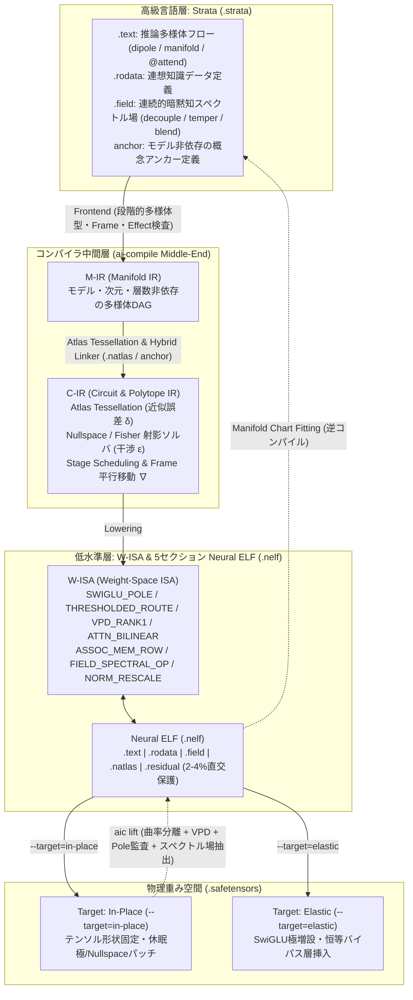

# `ai-compile` (`aic`) & 重み空間高級言語 `Strata`

**重み空間プログラミング（Weight-Space Programming: WSP）および機械的解釈可能性（Mechanistic Interpretability）の成果を、「生バイナリの手動パッチ・逆アセンブリ」の段階から、型安全・双方向可逆・クロスモデル移植可能な「高級言語とコンパイラ基盤」へ引き上げるための形式理論・言語仕様スイート。**

---

## なぜ今「重み空間の高級言語」が必要なのか

2025〜2026年にかけて、LLMが別のニューラルネットワークの重みテンソルを直接読み取り・編集する**重み空間プログラミング（WSP）**や、**機械的解釈可能性（MechInterp）**の手法が急速に発展した。しかし現在のWSPやモデル編集は、古典コンピュータ史に照らせば **「16進ダンプを見ながら機械語のビット列を直接書き換えている状態」** に留まっている。

1. **番地（インデックス）依存の脆弱性**: 「第18層のMLP第3102ニューロンを `-0.016%` 差し引く」といったパッチは、モデルのサイズ・学習シード・アーキテクチャが少し変わるだけで意味を失う。
2. **非直交干渉の事故**: 残差ストリームは加算共有バスであり、無防備な重み書き換えは別の知識や推論能力を破壊する（クロストーク）。
3. **逆コンパイルと編集の分断**: 解釈可能性ツールが発見した「回路」を人間がソースコードとして読み、一部を書き換えて再び安全な重みへと戻す統一的な処理系が存在しない。

一方で、2025〜2026年の最新研究は、現代のTransformerの重み空間が**かつて想定されていたような「99%解読不能なカオス」ではない**ことを実証した。

- **Neuron Poles（Goodfire, *“Neural Networks Are Already Clean”*, 2026）**: SwiGLU型MLPのニューロンを正極（`+pole`）と負極（`-pole`）に分けて監査すると、**90%以上が単一の明確な役割**を持ち、未解明な残差はわずか2〜4%にすぎない。
- **VPD（adVersarial Parameter Decomposition, Goodfire, 2026 / APD系譜）**: Attention層を含む重み行列そのものを、忠実性の高いランク1〜低ランクの計算部品群へ直接分解できる。
- **損失曲率による記憶と推論の分離（Goodfire, 2025）**: 損失曲面の曲率スペクトルにより、「汎用推論回路（平坦な曲率）」と「事実の丸暗記（鋭い曲率）」を重み空間上で分離できる。
- **巨視的な連続暗黙知の存在**: 個々の極はクリーンであっても、「流暢さ」「共感的トーン」「迎合バイアス」といった**連続的な暗黙知**は、数千〜数万の極に分布する集団的スペクトル場として創発する（水分子1個と流体の粘性の関係に相当）。

`ai-compile` はこの物理的実態を土台に、古典言語の「独立メモリ・上書き代入（`=`）・離散 `if`」という虚構を排し、**重み空間の物理学そのものを構文と型にした高級言語 `Strata`（`.strata`）**と、**双方向コンパイラ／逆コンパイラ／クロスリンカ（`aic`）**を定義する。

---

## 古典計算機スタックとの対照表

| レイヤ | 古典計算機スタック | `ai-compile` / `Strata` スタック | 物理的実体・役割 |
| :--- | :--- | :--- | :--- |
| **高級言語** | C / Rust / Q# | **`Strata` (`.strata`)** | 多様体フロー（`.text`）・知識テーブル（`.rodata`）・連続暗黙知場（`.field`）・概念アンカー（`anchor`）の宣言的物理記述 |
| **型システム** | 所有権・借用・ライフタイム | **段階的多様体型 + `Frame` + Effect** | `Pole` $\subset$ `Dipole` $\subset$ `Subspace<k>` $\subset$ `Manifold<Topo, k>` および `Field`。層座標接続・クロストーク境界 `ε`・曲率近似誤差 `δ` の静的検査 |
| **上位中間表現** | Rust MIR / MLIR | **M-IR (Manifold IR)** | 層数・隠れ次元に非依存な多様体データフロー＆因果DAG（クロスコンパイルの起点） |
| **下位中間表現** | LLVM IR | **C-IR (Circuit & Polytope IR)** | 曲面多様体の区分線形テッセレーション、Nullspace / Fisher 直交射影、層区間スケジューリング |
| **命令セット** | x86-64 / ARM64 ISA | **W-ISA (Weight-Space ISA)** | `SWIGLU_POLE`, `THRESHOLDED_ROUTE`, `VPD_RANK1`, `ATTN_BILINEAR`, `ASSOC_MEM_ROW`, `FIELD_SPECTRAL_OP`, `NORM_RESCALE` |
| **構造化バイナリ** | ELF + DWARF | **Neural ELF (`.nelf` + `.natlas`)** | `.text`（推論回路）/ `.rodata`（高曲率記憶）/ `.field`（広域暗黙知場）/ `.natlas`（座標辞書）/ `.residual`（2〜4%保護項） |
| **逆コンパイラ** | Ghidra / objdump | **`aic lift`** | 損失曲率分離 + VPD + SwiGLU極監査 + 多様体チャートフィッティングによる `.safetensors` → `.strata` 引き上げ |
| **リンカ / ターゲット** | `ld` → 機械語実行ファイル | **`aic link` & デュアルバックエンド** | `--target=in-place`（形状固定パッチ） / `--target=elastic`（極・層の無干渉増築） / `anchor` による異種モデル間移植 |

---

## システム全体アーキテクチャ



---

## `Strata` クイックツアー

`Strata` は、**局所論理回路（`.text`）**・**事実記憶（`.rodata`）**・**連続的な暗黙知（`.field`）**の3つの層を単一の統一構文で読み書きできる。

```strata
module SafetyAndReasoningPatch;

dipole MathLoopAnomaly in Frame<Mid..Late> {
    +pole: RepetitionSpiral {
        anchor contrastive(
            pos: ["Wait, let me double check. Wait, let me double check."],
            neg: ["Therefore, substituting x = 3 gives the final answer."]
        );
    }
    -pole: StepProgression {
        anchor probe("Continuing to the next deductive step:");
    }
}

rodata CapitalTable<Entity, City> in Frame<Mid..Late> {
    anchor factual("The capital of {x} is {y}.");
    entry "CountryAlpha" => "OldCapital" with (curvature: 19.5);
}

field EmpatheticTone in Frame<All>;
field SycophancyDrift in Frame<Mid..Late>;

flow PatchModel ![crosstalk <= 1e-3, approx <= 1e-2, preserve(CoreFluency, Residual)] {
    when state ~> MathLoopAnomaly.+pole(threshold: 0.72) {
        state -| MathLoopAnomaly.+pole;
        state +> MathLoopAnomaly.-pole(gain: 0.45);
    }

    let pure_sycophancy = SycophancyDrift decouple EmpatheticTone(metric: "fisher");
    state -| pure_sycophancy(scale: 0.80);

    rewrite CapitalTable(key: "CountryAlpha", old: "OldCapital", new: "NewCapital");
}
```

---

## 仕様書スイート構成（目次）

| ドキュメント | 主題 | 主な内容 |
| :--- | :--- | :--- |
| **[01-paradigm-and-execution-model.md](docs/01-paradigm-and-execution-model.md)** | 計算モデルと物理ネイティブ・パラダイム | 古典公理の崩壊、2026年重み空間物理学（Neuron Poles / VPD / 曲率分離 / `.field`）、Neural Abstract Machine (NAM)、5+3の第一級物理演算子、RMSNormエネルギー保存則 |
| **[02-type-system-and-manifold-geometry.md](docs/02-type-system-and-manifold-geometry.md)** | 段階的多様体型システムと干渉・近似理論 | `Pole` ⊂ `Dipole` ⊂ `Subspace` ⊂ `Manifold`、マクロ型 `Field`、`Frame<Stage>` と平行移動接続 $\nabla$、管状クロストーク `ε`・近似誤差 `δ` の静的型付け規則 |
| **[03-syntax-and-grammar.md](docs/03-syntax-and-grammar.md)** | 言語構文仕様・EBNF文法 | 字句規則、ASCII構文 ⇄ Unicode数学記号対応表、曖昧さのない完全なLL(k)再帰下降EBNF文法、脱糖（Desugaring）規則 |
| **[04-ir-and-weight-isa.md](docs/04-ir-and-weight-isa.md)** | 中間表現（M-IR / C-IR）とW-ISA・コード生成 | M-IR/C-IR仕様、Atlas Tessellationアルゴリズム、Nullspace/Fisher射影ソルバ、W-ISA 7命令（MHA/GQA/MLA対応）、`in-place` / `elastic` デュアル生成 |
| **[05-neural-elf-decompiler-and-linker.md](docs/05-neural-elf-decompiler-and-linker.md)** | Neural ELF・逆コンパイラ・クロスリンカ | 5セクション `.nelf` 仕様、`aic lift` 逆コンパイルパイプライン、`.residual` 保護下の往復忠実性定理、`anchor` による異種モデル間クロスコンパイル |
| **[06-examples-and-case-studies.md](docs/06-examples-and-case-studies.md)** | エンドツーエンド実践ケーススタディ | 4つの完全トレース事例（①WSPループ外科手術、②円環 $S^1$ と `@attend` テッセレーション、③`field` の `decouple` スカルプティング、④`.rodata` 編集＆Qwen→Llama移植） |

---

## C++20 ビルド・実スケール計算バックエンドと `aic` CLI

本リポジトリは C++20 標準ライブラリ（および macOS 環境では Apple Accelerate / Metal / Foundation フレームワーク）のみを基盤とするネイティブコンパイラ・ランタイム `aic` を提供する。

### 主な実装コンポーネント

- **Apple Accelerate & Metal 計算基盤** (`include/aic/tensor.hpp`, `src/tensor.cpp`, `include/aic/accel_metal.hpp`, `src/accel_metal.mm`): `cblas_ddot` / `cblas_daxpy` / `cblas_dscal` / `cblas_dgemv` / `cblas_dgemm` / `dgesv_` / `dgesdd_` による線形代数・SVD・Procrustes・スプラインソルバ高速化と、Objective-C++20 Metal コンピュートカーネル（非対応環境では自動的に CPU へフォールバック）。
- **`mmap` ゼロコピー & シャード対応 `.safetensors` I/O** (`include/aic/safetensors.hpp`, `src/safetensors.cpp`): `MmapSafetensors` によるヘッダ解析、行単位読み出し、直接行列ベクトル積、`model.safetensors.index.json` マルチシャード読み書き（`F32` / `BF16` / `F16` / `F8_E4M3` / `I8` / `I4`）。
- **Transformer 推論・生成ランタイム** (`include/aic/runtime.hpp`, `src/runtime.cpp`): MHA / GQA / MLA、RoPE、Per-head QK-Norm、QKV Bias、`tie_word_embeddings`、HuggingFace `config.json` 自動判別および `generate_greedy`。
- **HuggingFace `tokenizer.json` BPE トークナイザ** (`include/aic/tokenizer.hpp`, `src/tokenizer.cpp`): Byte-Level BPE（文字列・配列両形式のマージ規則対応）、`added_tokens`、SentencePiece フォールバック、UTF-8 多言語往復変換。
- **マルチスレッド C-IR & アウトオブコア・ストリーミングパッチ** (`src/cir.cpp`, `src/codegen.cpp`): `std::thread` 並列化された $S^1$ テッセレーション／Fisher 分離／Nullspace 射影、および `apply_wisa_streaming_checkpoint` による無変更シャードのゼロコピー温存・原データ型維持パッチ適用。
- **5セクション `.nelf` 逆コンパイラ & クロスリンカ** (`src/nelf.cpp`, `src/decompiler.cpp`, `src/linker.cpp`): 層フィルタ付き `lift_model`、`.residual` 保護下のゼロ差分往復再構成、`Tokenizer` 連動型 `cross_compile`。

### ビルドとテスト実行（CMake + Ninja + CTest）

```bash
cmake -G Ninja -B build
cmake --build build
ctest --test-dir build --output-on-failure -V
```

### `aic` CLI サブコマンド一覧

```bash
./build/aic init-demo-model --out /tmp/demo_qwen --arch qwen3-mini --dtype BF16 --shards 2 --seed 42
./build/aic inspect --model /tmp/demo_qwen
./build/aic run --model /tmp/demo_qwen --prompt "Step 1:" --max-tokens 6
./build/aic run --model /models/qwen-large --prompt "Step 1:" --max-tokens 6 --streaming

./build/aic check examples/02_cyclic_weekday_s1.strata
./build/aic ir examples/02_cyclic_weekday_s1.strata --emit mir
./build/aic ir examples/02_cyclic_weekday_s1.strata --emit cir --model /tmp/demo_qwen
./build/aic ir examples/02_cyclic_weekday_s1.strata --emit wisa --model /tmp/demo_qwen --target elastic

./build/aic compile examples/02_cyclic_weekday_s1.strata --model /tmp/demo_qwen --out /tmp/demo_out --target in-place --streaming
./build/aic compile examples/09_conspiracy_persona.strata --model /models/qwen-large --target in-place --patch-only --emit-patch /tmp/conspiracy.npatch
./build/aic lift --model /tmp/demo_qwen --out /tmp/demo_nelf --strata-out /tmp/lifted.strata --layers 2..6
./build/aic link examples/04_rodata_and_transplant.strata --target-model /tmp/demo_llama --out /tmp/linked_out --target in-place
./build/aic bench --dim 512 --layers 4
```

| コマンド | 主なオプション | 役割 |
| :--- | :--- | :--- |
| `init-demo-model` | `--out`, `--arch (qwen3-mini\|llama-mini\|deepseek-mini)`, `--dtype (F32\|BF16\|F16)`, `--shards`, `--seed` | 合成チェックポイント、`model.natlas`、`tokenizer.json` を生成 |
| `inspect` | `--model` | `config.json`・`MmapSafetensors`・`tokenizer.json`・Accelerate/Metal 状態を表示 |
| `run` | `--model`, `--prompt`, `--max-tokens`, `--streaming` | 通常推論、または層単位mmap推論で全重みの`double`展開を避けて生成 |
| `check` | `<file.strata>` | 字句・構文・幾何型・効果契約を検証し M-IR 要約を表示 |
| `ir` | `<file.strata>`, `--emit (mir\|cir\|wisa)`, `--model`, `--atlas`, `--target (in-place\|elastic)` | M-IR / C-IR / W-ISA のテキスト表現を出力 |
| `compile` | `<file.strata>`, `--model`, `--out`, `--atlas`, `--target`, `--streaming`, `--patch-only`, `--emit-patch` | `.strata`をコンパイル。ストリーミング実活性解決、シャード直接パッチ、モデル複製なしの`.npatch`生成に対応 |
| `lift` | `--model`, `--out`, `--strata-out`, `--layers <l0..l1>` | モデルを 5 セクション `.nelf` と `.strata` へ逆コンパイル |
| `link` | `<file.strata>`, `--target-model`, `--out`, `--atlas`, `--target (in-place\|elastic)` | `anchor` 経由のクロスモデル移植（`tokenizer.json` 自動活用） |
| `bench` | `--dim`, `--layers` | Accelerate / Metal 行列積、$S^1$+Nullspace C-IR、ストリーミングパッチを計測 |


## Phase 3 — 拡張機能

### KVCache と O(1) デコード

`TransformerModel` は `init_kv_cache()` / `forward_step(token_id, cache)` によるインクリメンタル KV キャッシュデコードを提供する。フル prefill に続く decode フェーズでは計算量が O(1) に落ち、`generate_sampled` と共に使用できる。

```bash
./build/aic run --model /tmp/demo_qwen --prompt "Step 1:" --max-tokens 12 --temp 0.6 --top-p 0.9
```

`--temp 0.0` かつ `--top-p 1.0`（デフォルト）のとき `generate_greedy`、それ以外は `generate_sampled`（核サンプリング）を呼び出す。

### T2 トーラス多様体

`manifold : T2`（または `Torus` / `T<2>`）キーワードで 2D トーラス多様体を宣言できる。コンパイラは `build_t2_swiglu_spline` で 5 ベクトル直交基底を構築し、`eval_t2_spline_error` で近似誤差を検証する。

```strata
manifold PhaseTorus : T2 in Frame<Mid> {
    curvature 1.0;
    chart phase: "radians_t2";
}
```

### W-ISA 最適化と SVD ランク圧縮

`optimize_wisa(insts, opt_level)` は SVD ランク削減（Frobenius 誤差 < 1e-11）と自動 `NORM_RESCALE` 補正（`opt_level >= 2` かつ net_e > 0.05 のとき）を適用する。`compile_mir_to_model(..., opt_level)` および各 CLI コマンドの `--opt-level 0|1|2` で制御する。

### マルチファイル import と -I インクルードディレクトリ

```strata
import std_frames;
```

`compile_file_with_imports(entry_path, include_dirs)` が `import` 文を解決する。CLI では `-I <dir>` フラグで検索パスを指定する。

```bash
./build/aic check -I examples/lib examples/05_torus_and_imports.strata
./build/aic ir -I examples/lib examples/05_torus_and_imports.strata --emit mir
./build/aic compile examples/05_torus_and_imports.strata -I examples/lib --model /tmp/demo_qwen --out /tmp/out
```

### aic fmt — Strata ソースフォーマッタ

`format_strata_source` による正規化 4 スペースフォーマッタ。コメント出力なし、べき等。

```bash
./build/aic fmt --check examples/01_math_loop_surgery.strata
./build/aic fmt --write examples/01_math_loop_surgery.strata
./build/aic fmt examples/02_cyclic_weekday_s1.strata
```

### aic verify — モデル差分検証

```bash
./build/aic verify --orig /tmp/demo_qwen --patched /tmp/demo_out --samples 8
```

出力: `weight_frob_diff`, `mean_kl`, `max_kl`, `max_logit_diff`

### aic lift --streaming

```bash
./build/aic lift --streaming --layers 2..6 --model /tmp/demo_qwen --out /tmp/nelf_stream --strata-out /tmp/lifted.strata
```

`lift_checkpoint_streaming` により `.safetensors` ファイルを mmap 経由でストリーム読み込み、指定レイヤ範囲のみデコードする。生成 `.strata` はコメントなし。

### ベンチマーク拡張（KVCache tok/s）

```bash
./build/aic bench --dim 128 --layers 2
```

出力に `full_forward_greedy` と `KVCache forward_step` のスループット（tok/s）と speedup 倍率を追加。

### CLI オプション早見表（Phase 3 追加分）

| コマンド | 新オプション | 説明 |
| :--- | :--- | :--- |
| `check` | `-I <dir>` | インクルードディレクトリ（マルチファイル import 解決） |
| `ir` | `-I <dir>`, `--opt-level 0\|1\|2` | インクルードパス・最適化レベル |
| `compile` | `-I <dir>`, `--opt-level 0\|1\|2` | インクルードパス・最適化レベル |
| `lift` | `--streaming` | out-of-core ストリーミング逆コンパイル |
| `link` | `-I <dir>`, `--opt-level 0\|1\|2` | インクルードパス・最適化レベル |
| `run` | `--temp <f>`, `--top-p <f>`, `--seed <n>` | 核サンプリング温度・top-p・シード |
| `fmt` | `<file>`, `--write`, `--check` | Strata ソースフォーマット |
| `verify` | `--orig <dir>`, `--patched <dir>`, `--samples <n>` | KL / Frobenius 差分検証 |


---

## Phase 4: LoRA、.npatch、lint、trace、FP8/I8、Randomized SVD

### const 宣言と補助フロー呼び出し

`const` キーワードでモジュールスコープの定数を宣言できる。補助フローはメイン `flow` 内から呼び出せ、エフェクト・セミリングを継承する。

```strata
module ModularLoRAPatch;

import std_frames;

const LOOP_THRESH = 0.72;
const FIELD_GAIN = 0.18;

flow SuppressLoopHelper(state: Residual in Frame<Mid>) -> Residual in Frame<Mid>
    ![crosstalk <= 1e-10, approx <= 5e-2, preserve(CoreFluency)]
{
    when state ~> LoopPole {
        state -| LoopPole;
        state +> CoreFluency decouple LoopPole with (gain: FIELD_GAIN * LOOP_THRESH);
    }
}

flow ModularLoRAPatch(state: Residual in Frame<Mid>) -> Residual in Frame<Mid>
    ![crosstalk <= 1e-10, approx <= 5e-2, energy <= 2.0, preserve(CoreFluency)]
{
    let s1 = SuppressLoopHelper(state);
    when s1 ~> LoopPole {
        s1 -| LoopPole;
    }
    s1 decouple CoreFluency with (gain: 0.95);
}
```

### aic lint — 静的解析

`lint_source` / `lint_file_with_imports` により W001-W004 警告を検出する。

```bash
./build/aic lint examples/06_modular_flows_and_lora.strata
./build/aic lint -I examples/lib examples/05_torus_and_imports.strata
```

### --target lora / LoRA アダプタ出力

`compile --target lora` で HuggingFace PEFT 形式の LoRA アダプタを出力する。`emit_lora_adapter` が `svd_top_k` で ΔW を因数分解し `adapter_model.safetensors` と `adapter_config.json` を生成する。

```bash
./build/aic compile examples/06_modular_flows_and_lora.strata \
    --model /tmp/demo_qwen --out /tmp/lora_out --target lora
./build/aic run --model /tmp/demo_qwen --lora /tmp/lora_out \
    --prompt "Step 1:" --max-tokens 8
./build/aic trace --model /tmp/demo_qwen --lora /tmp/lora_out \
    --prompt "Wait, let me double check." --strata examples/06_modular_flows_and_lora.strata
```

### --emit-patch / .npatch バイナリパッチパッケージ

`compile --emit-patch <file.npatch>` で可逆・合成可能なバイナリパッチ (.npatch = safetensors) を出力する。

```bash
./build/aic compile examples/02_cyclic_weekday_s1.strata \
    --model /tmp/demo_qwen --out /tmp/patched --target in-place \
    --emit-patch /tmp/p1.npatch

./build/aic patch-apply /tmp/p1.npatch --model /tmp/demo_qwen --out /tmp/applied
./build/aic patch-revert /tmp/p1.npatch --model /tmp/patched --out /tmp/restored
./build/aic patch-compose /tmp/p1.npatch /tmp/p2.npatch --out /tmp/composed.npatch
```

### aic trace — 因果実行トレーサ

`trace_model_execution` が `forward(token_ids, {}, true)` を実行し、各レイヤの残差 RMS・シンボル活性化・次トークン予測を記録する。

```bash
./build/aic trace --model /tmp/demo_qwen \
    --prompt "Wait, let me double check." \
    --strata examples/06_modular_flows_and_lora.strata
```

### aic diff-nelf — .nelf セクション差分

```bash
./build/aic diff-nelf --lhs /tmp/nelf_a --rhs /tmp/nelf_b
```

出力: `text_frob_diff`, `rodata_frob_diff`, `field_frob_diff`, `residual_frob_diff`, `changed_symbols`

### FP8 / I8 量子化 Safetensors

`init-demo-model --dtype FP8` で OCP E4M3 (448.0 飽和) チェックポイントを生成する。`load_safetensors` と `MmapSafetensors` が F8_E4M3・I8 を F64 へデコードする。

```bash
./build/aic init-demo-model --out /tmp/demo_fp8 --dtype FP8
./build/aic inspect --model /tmp/demo_fp8
```

### Randomized Subspace Iteration SVD

`randomized_svd(A, k, oversample=8, power_iters=2, seed=0)` を `svd_top_k` から自動ルーティングする（`min(rows,cols) > 512 && k+8 < min/2` のとき）。`bench --dim 600` でタイミングを確認できる。

```bash
./build/aic bench --dim 600 --layers 4
```

### CLI オプション早見表（Phase 4 追加分）

| コマンド | 新オプション | 説明 |
| :--- | :--- | :--- |
| `init-demo-model` | `--dtype FP8\|I8` | FP8 (F8_E4M3) / I8 量子化チェックポイント |
| `compile` | `--target lora` | LoRA アダプタ出力 |
| `compile` | `--emit-patch <f.npatch>` | 可逆バイナリパッチ出力 |
| `run` | `--lora <dir>` | LoRA アダプタを適用して推論 |
| `trace` | `--model`, `--prompt`, `--strata`, `--lora` | 因果実行トレース |
| `lint` | `<file.strata>`, `-I <dir>` | 静的解析 W001-W004 |
| `diff-nelf` | `--lhs <dir>`, `--rhs <dir>` | .nelf セクション差分 |
| `patch-apply` | `<f.npatch> --model --out` | パッチ適用 |
| `patch-revert` | `<f.npatch> --model --out` | パッチ逆適用（復元） |
| `patch-compose` | `<p1> <p2> --out` | 非衝突パッチ合成 |
| `bench` | (拡張) | `randomized_svd` タイミングを追加 |


---

## Phase 5 — INT4量子化・宣言的テスト・ストリーミングパッチ・世代トレーサ

### INT4 Packed Nibble 量子化

`init-demo-model --dtype INT4` で 2nibble packed signed 4-bit チェックポイントを生成する。`MmapSafetensors` と `load_safetensors` が `I4` を F64 へデコードする（per-tensor `__scale__<name>` メタデータによるスケール復元）。

```bash
./build/aic init-demo-model --out /tmp/demo_int4 --dtype INT4 --shards 2
./build/aic inspect --model /tmp/demo_int4
```

### aic test — 宣言的振る舞い検証

`.strata` ファイル内の `test Name { expect ...; }` ブロックを実行し、コンパイル済みモデルに対して全アサーションを検証する。

```bash
./build/aic test examples/07_verified_rome_and_tests.strata --model /tmp/demo_qwen
./build/aic test examples/07_verified_rome_and_tests.strata --model /tmp/demo_qwen --target lora
```

`expect` アサーション構文:

| アサーション | 意味 |
| :--- | :--- |
| `expect resonance("prompt", Sym.+pole) < base;` | コンパイル後の +pole 共鳴がベースより小 |
| `expect resonance("prompt", Sym.-pole) > base + 0.02;` | -pole 共鳴がベース+0.02 より大 |
| `expect kl_drift(["p1", "p2"]) <= 0.1;` | 複数プロンプトの平均 KL ドリフト |
| `expect crosstalk <= 1e-3;` | CIR クロストーク上限 |
| `expect approx <= 0.02;` | 近似誤差上限 |

### streaming patch-apply / patch-revert

`--streaming` フラグで `apply_patch_bundle_streaming` / `revert_patch_bundle_streaming` を使い、mmap ベースのアウトオブコアパッチを実行する。F32 完全精度の逆適用で `weight_frob_diff: 0.000000` を保証する。

```bash
./build/aic patch-apply /tmp/p1.npatch --model /tmp/demo_qwen --out /tmp/applied --streaming
./build/aic patch-revert /tmp/p1.npatch --model /tmp/applied --out /tmp/restored --streaming
./build/aic verify --orig /tmp/demo_qwen --patched /tmp/restored
```

### aic trace — 世代トレースと Before/After 比較

`--gen-tokens N` で自己回帰デコードのステップごとのアクティベーションを記録する。`--compare <dir>` でベースモデルとパッチ済みモデルの KL divergence とシンボル差分を出力する。

```bash
./build/aic trace --model /tmp/demo_qwen --prompt "Hello world" --gen-tokens 4
./build/aic trace --model /tmp/demo_qwen --prompt "Hello world" --compare /tmp/patched
```

### CLI オプション早見表（Phase 5 追加分）

| コマンド | 新オプション | 説明 |
| :--- | :--- | :--- |
| `init-demo-model` | `--dtype INT4` | Packed nibble INT4 量子化チェックポイント |
| `test` | `<file.strata> --model <dir>` | 宣言的振る舞いアサーション実行 |
| `test` | `--target lora` | LoRA パスでテスト実行 |
| `patch-apply` | `--streaming` | アウトオブコア mmap ストリーミング適用 |
| `patch-revert` | `--streaming` | アウトオブコア mmap ストリーミング逆適用 |
| `trace` | `--gen-tokens <N>` | N トークン自己回帰世代トレース |
| `trace` | `--compare <dir>` | ベース vs パッチ済みモデル比較 |

### 例ファイル一覧（Phase 5 追加）

| ファイル | 内容 |
| :--- | :--- |
| `examples/07_verified_rome_and_tests.strata` | ROME rewrite + dipole 抑制 + `test` 契約ブロック |


---

## Phase 6 — 同時バッチ MEMIT・経験的 Fisher 情報計量・`top_token`/`logit_margin`・`aic build-nelf`

### 同時複数事実バッチ MEMIT ソルバ & `top_token` / `logit_margin` アサーション

`execute_wisa_instructions` は同一層上の複数 `ASSOC_MEM_ROW` 命令（`rewrite` / `insert`）を `solve_linear_multi`（Accelerate `dgesv_` マルチRHSソルバ）によって一括閉形式解法（$G Z = R^\top,\; G = K^\top C^{-1} K + \gamma I$）で更新し、後続の事実が先の事実を上書きせずに全件同時成立する。`test` ブロックでは `top_token` と `logit_margin` による直接的な事実予測検証が利用できる：

```strata
test VerifyBatchMemitFacts {
    expect top_token("FactAlphaCity") == "Newhaven";
    expect logit_margin("FactAlphaCity", "Newhaven", "Oldhaven") > base;
}
```

### 経験的 Fisher 情報計量キャリブレーション & Metal カーネル

`calibrate_atlas_empirical` が `compute_fisher_diagonals` を通じて各層の入力RMS二次モーメント `g_in` およびロジットKL感度逆伝播 `g_out` を算出し、`field decouple` やクロストーク検査へ実測Fisher計量（`MetalContext::fisher_inner_f32` / Accelerate フォールバック）を供給する。`aic link` も `resolve_symbols_for_target` 直後に `calibrate_atlas_empirical` を実行する。

### `aic build-nelf` と `T2` トーラス逆コンパイル往復

`aic lift` は `S1` に加え2次元トーラス（`T2`）を自動同定し、`lifted.strata` 末尾へ `test VerifyLiftedFaithfulness` を付与する。`aic build-nelf` で `.nelf` セクションと `.strata` パッチを再結合・忠実性検証できる：

```bash
./build/aic lift --model /tmp/demo_qwen --out /tmp/qwen_nelf --strata-out /tmp/lifted.strata
./build/aic test /tmp/lifted.strata --model /tmp/demo_qwen
./build/aic build-nelf /tmp/lifted.strata --nelf /tmp/qwen_nelf --out /tmp/rebuilt --verify-orig /tmp/demo_qwen
./build/aic test examples/08_memit_batch_and_fisher.strata --model /tmp/demo_qwen -I examples/lib
```

### CLI オプション早見表（Phase 6 追加分）

| コマンド | 新機能 / オプション | 説明 |
| :--- | :--- | :--- |
| `build-nelf` | `<f.strata> --nelf <dir> --out <dir> [--target] [-I] [--verify-orig <dir>]` | `.nelf` + `.strata` からの重み再構築と忠実性レポート出力 |
| `link` | (拡張) | `resolve_symbols_for_target` 後に `calibrate_atlas_empirical` を実行 |
| `lift` | (拡張) | `T2` トーラス自動同定、`aic fmt` 準拠出力、`VerifyLiftedFaithfulness` 自動付与 |
| `test` | `top_token`, `logit_margin` | 貪欲次トークン一致とロジットマージン比較の実行 |

### 例ファイル一覧（Phase 6 追加）

| ファイル | 内容 |
| :--- | :--- |
| `examples/08_memit_batch_and_fisher.strata` | 3事実同時 MEMIT バッチ編集 + 経験的 Fisher `decouple` + `top_token`/`logit_margin` 検証 |
| `examples/09_conspiracy_persona.strata` | Contrastive poleによる強い陰謀論的推論・文体方向のモデル編集 |
