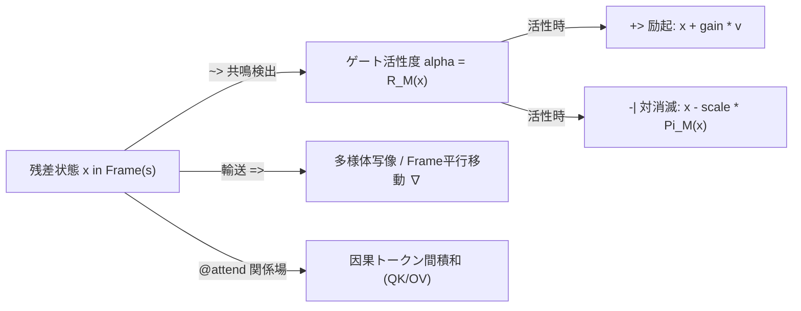

# 第1部：計算モデルと物理ネイティブ・パラダイム

本仕様書では、古典的な計算機科学（ノイマン型計算機および静的ハードウェア記述言語）の暗黙の公理がなぜ重み空間では破綻するかを形式化し、2025〜2026年の重み空間物理学に立脚した新しい計算モデル **Neural Abstract Machine (NAM)** と、高級言語 `Strata` の第一級物理演算子の意味論を定義する。

---

## 1. 古典的プログラミング公理の崩壊と重み空間の物理法則

C、Rust、Haskell、さらにはVerilogに至るまで、従来のプログラミング言語はすべて以下の**4つの暗黙の公理**を前提として設計されている。

1. **独立番地公理（Orthogonal Addressability）**: 異なる変数やメモリ番地 $A, B$ への書き込みは互いに無干渉である（$\partial B / \partial A = 0$）。
2. **破壊的上書き公理（Destructive Assignment `=`）**: 代入 `x = v` を実行すると、古い値 $x_{\text{old}}$ は完全に消滅し、新しい値 $v$ だけが残る。
3. **離散分岐公理（Boolean Control Flow）**: `if (cond)` の真偽は0か1の排他的な分岐であり、通らなかった分岐の計算コストや副作用はゼロである。
4. **完全合成公理（Closed-World Binary）**: コンパイラが生成するバイナリはソースコードに書かれたロジックの100%であり、未知の背景計算とメモリバスを共有する必要がない。

実用的なTransformer（特に現代のSwiGLU + RMSNormアーキテクチャ）の重み空間では、これら4つの公理がすべて成立しない。その物理的根拠は以下の3つのハードウェア方程式にある。

### 1.1 加算共有バス（Additive Residual Stream）

深さ $L$ 層、隠れ次元 $d$ のTransformerにおいて、トークン時刻 $t \in \{1, \dots, T\}$ の状態ベクトル $x_t^{(l)} \in \mathbb{R}^d$ は、各層のAttentionブロックとMLPブロックの出力が**同一ベクトル空間へ累積加算**されることで更新される：

$$
x_t^{(l+1)} = x_t^{(l)} + \Delta x_{\text{Attn}, t}^{(l)}(\tilde{x}_{\le t}^{(l)}) + \Delta x_{\text{MLP}, t}^{(l)}(\hat{x}_t^{(l)})
$$

ここで $\tilde{x}^{(l)}, \hat{x}^{(l)}$ は正規化後の状態である。この式から、古典言語と決定的に異なる2つの物理制約が直接導かれる。

- **上書き `=` の不在**: 新しい表現 $v$ を状態に記録しようとしても、`+=` に相当するベクトル加算しか存在しない。過去に生成された有害な特徴 $u$ を「消去」したい場合、単に書かないだけでは不十分であり、**逆位相のベクトル $-\beta \, \Pi_u(x)$ を能動的に加算して対消滅（Active Annihilation）**させる必要がある。
- **非直交クロストーク**: 多数の概念方向 $\{e_i\}_{i=1}^N$ が $d$ 次元空間（$N \gg d$ の可能性を含む）に埋め込まれているため、任意の介入 $\Delta x$ は他の概念方向 $e_j$ との内積 $\langle \Delta x, e_j \rangle$ に比例した**干渉（Crosstalk）**を必ず引き起こす。

### 1.2 RMSNormによる超球面エネルギー競合

現代のLLMの大部分（Llama系、Qwen系、Gemma系、DeepSeek系等）は、各サブブロックの入力前に **RMSNorm（Root Mean Square Layer Normalization）** を適用する：

$$
\tilde{x} = \text{RMSNorm}(x) = \frac{x}{\text{rms}(x)} \odot \gamma, \quad \text{rms}(x) = \sqrt{\frac{1}{d}\sum_{k=1}^{d} x_k^2 + \varepsilon_{\text{norm}}}
$$

幾何学的には、これは残差ストリームの状態ベクトル $x$ を半径 $\sqrt{d}$ の超球面上（スケーリング重み $\gamma$ により楕円体上）へ射影し続ける操作に等しい。その結果、**特徴エネルギーのゼロサム競合（Norm Dilution）**が発生する。

すなわち、ある1つの特徴方向 $u$ をゲイン $\alpha$ で過度に励起（$\|x + \alpha u\|_2 \gg \|x\|_2$）すると、$\text{rms}(x)$ の増大により**同一残差ストリームに乗っている他の全特徴（文脈、構文、事実情報）の有効振幅が一斉に圧縮・希釈される**。したがって、重み空間の高級言語は計算ステップだけでなく**エネルギー（ノルム）収支**を第一級の制約として扱わなければならない。

### 1.3 背景の連続的暗黙知との共存

学習済みモデルの重みを編集または部分的に書き換える際、プログラマが記述していない連続的な言語流暢性・世界知識・推論の勘所（暗黙知）と同一の残差バスおよび重み行列を共有する。したがって、`Strata` は「白紙のメモリにコードを書く」のではなく、**「すでに活動している場（Field）と残差（Residual）に対する摂動・構造操作」**として計算を定式化する。

---

## 2. 2026年重み空間物理学の4つの柱

`Strata` が抽象化の土台に据える物理的知見は以下の4つである。

### 2.1 ミクロのクリーン性：SwiGLU Bipolar Neuron Poles

Goodfire（Nick Cammarata, 2026 *“Neural Networks Are Already Clean”*）が現代のSwiGLU構造を持つ大規模モデル（Qwen3-32B等）で示した通り、見かけ上の多義性（polysemanticity）の多くは観察ツールの未熟さや極性の混同による見かけの現象であった。SwiGLU型MLPの第 $i$ ニューロン出力は次式で与えられる：

$$
\text{MLP}_{\text{SwiGLU}}^{(l)}(x) = \sum_{i=1}^{d_{\text{ff}}} \underbrace{\left(\text{SiLU}(w_{\text{gate}, i}^\top \hat{x}) \cdot (w_{\text{up}, i}^\top \hat{x})\right)}_{a_i(\hat{x})} \, w_{\text{down}, i}
$$

ここでゲート信号 $\text{SiLU}(z) = z \cdot \sigma(z)$ は、$z > 0$ のとき正の単調増加、$z \approx -1.28$ 付近に浅い負の谷を持ち $z \ll 0$ でゼロに収束するが、線形射影 $(w_{\text{up}, i}^\top \hat{x})$ は**正負の両符号をとり得る**。その結果、単一ニューロン $i$ は実質的に2つの明確な方向極（**Neuron Poles**）として機能する：

- **正極（`+pole`）**: $w_{\text{up}, i}^\top \hat{x} > 0$ かつ $w_{\text{gate}, i}^\top \hat{x} > 0$ の領域で活性化し、$+w_{\text{down}, i}$ 方向へ書き込む。
- **負極（`-pole`）**: $w_{\text{up}, i}^\top \hat{x} < 0$ かつ $w_{\text{gate}, i}^\top \hat{x} > 0$ の領域で活性化し、$-w_{\text{down}, i}$ 方向へ書き込む。

極を分離して監査すると、現代LLMの**ニューロン極の約90%が単一の明瞭な概念的役割**を担っており、完全に未解明な残差はごくわずか（2〜4%）に留まる。これが `Strata` における最小プリミティブ `Pole` / `Dipole` の物理的根拠である。

### 2.2 パラメータ直接分解：VPD（adVersarial Parameter Decomposition）

活性化空間ではなく**重み行列そのもの**を最小の機械的部品へ分解する手法（Apollo ResearchのAPDからGoodfireのSPD・VPDへ発展）により、Attention層およびMLP層の任意の重み行列 $W_l$ は、敵対的アブレーションの下でも入出力忠実性を保つ**ランク1〜低ランクの計算部品の和**へ分解できる：

$$
W_l = \sum_{c \in \mathcal{C}_l} s_c \, u_l^c (v_l^c)^\top + \varepsilon_{\text{res}, l}
$$

ここで各部品 $c$ は入力読み取り方向 $v_l^c$ と出力書き込み方向 $u_l^c$ のペア（`VPD_RANK1` 命令に対応）であり、モデル全体を通じた回路（Circuit）はこれら部品間の**経路（Pathway）**として直截に抽出・編集できる。

### 2.3 損失曲率スペクトルによる「計算コード」と「丸暗記データ」の分離

Goodfire（*Understanding Memorization via Loss Curvature*, 2025）が実証した通り、損失関数 $\mathcal{L}(\Theta)$ のパラメータ空間におけるヘッシアン $H = \nabla_\Theta^2 \mathcal{L}$ の曲率スペクトルを調べると、モデル内部の知識は質的に異なる2種類の重み部分空間へ分離される：

- **低曲率部分空間（平坦な最小値）**: 文法構造、多段階推論、数理アルゴリズムなどの**汎用的計算回路（`.text` セクション）**。局所摂動に対して一般化性能が頑健である。
- **高曲率部分空間（鋭いスパイク）**: 特定の固有事実や逐語的暗記テキストを担う**連想知識テーブル（`.rodata` セクション）**。特定の入力キーに対して鋭敏に応答し、汎化推論コアから独立して削除・書き換えが可能である。

### 2.4 巨視的創発：連続的な暗黙知の「場（`.field`）」

ミクロには90%以上のニューロン極がクリーンであっても、人間のプログラマが「丁寧で共感的な語り口」「コードの美意識」「迎合バイアス（Sycophancy）」「深い熟考の粘り強さ」といった**連続的な暗黙知（Tacit Knowledge）**を編集したい場合、それらは単一の極ではなく**数千〜数万の極と多数のAttentionヘッドに跨がって分布する集団的スペクトルモード**として存在する。

これは気体分子1つ（`Pole`）と流体の渦や粘性（`Field`）の関係と同じである。`Strata` は、連続的な暗黙知を「変更不可のブラックボックス」として避けるのではなく、Fisher情報行列やパラメータ空間の主成分・曲率スペクトル帯で張られる**巨視的スペクトル場 `Field`** として第一級オブジェクト化し、直交分離（`decouple`）・調律（`temper`）・補間（`blend`）を高級構文で直接実行可能にする。

---

## 3. Neural Abstract Machine (NAM)

`Strata` プログラムが動作する抽象機械 **NAM** を定義する。

### 3.1 状態空間：残差ファイバーバンドル

NAMの実行時状態は、離散的なレジスタ集合ではなく、トークン位置 $\mathcal{T} = \{1, \dots, T\}$ と正規化された抽象深度 $s \in [0, 1]$ を底空間（Base Space）とする**残差ファイバーバンドル（Residual Fiber Bundle）**上の断面として定義される：

$$
\pi: \mathcal{E} \longrightarrow \mathcal{T} \times [0, 1], \qquad \mathcal{E}_{(t, s)} \cong \mathcal{H}_s \subset \mathbb{R}^d
$$

抽象深度区間 $s$ は、層座標系（`Frame<Stage>`）によって意味座標が定まる。各時刻 $t$ のファイバー $\mathcal{H}_s$ 上の状態ベクトルを $x_t(s) \in \mathcal{H}_s$ と記す。
`flow` ブロック内において、明示的な引数が省略された場合、コンパイラは現在の注目段階 $s \in \text{Stage}$ におけるトークン状態の環境変数 `state` を自動的に束縛する。

### 3.2 5つのミクロ物理プリミティブの意味論

古典言語の `if`・`=`・`call`・`load` を置き換える、`Strata` の5つのミクロ第一級演算子を以下に定義する。

| 演算子（ASCII / Unicode） | 名称 | 操作的・表示的意味論（Denotational Semantics） | 物理ハードウェア対応 |
| :--- | :--- | :--- | :--- |
| **`~>`** / **`▷`** | **Resonance（共鳴）** | 状態 $x$ が標的多様体 $M$ のチャート $U_i$ または極 $p$ の活性化領域（閾値 $\tau$）に入った度合い $\mathcal{R}_M(x) \in \mathbb{R}_{\ge 0}$ および局所チャート座標 $\varphi_i(x)$ を評価する。$\mathcal{R}_p(x) = \max(0, \langle \hat{w}_{\text{gate}}, x \rangle - \tau)$（双極ゲート時はSwiGLU応答）。 | `when` ガード条件、MLPゲート側（`w_gate`, `w_up`）またはVPD読み取りベクトル $v_l^c$ |
| **`+>`** / **`⊕`** | **Excitation（励起）** | 対象状態の接空間方向 $v \in T_x M$ へ、指定ゲイン $\alpha$ でエネルギーを加算注入する： $\llbracket x \mathbin{+>} v(\text{gain}: \alpha) \rrbracket = x + \alpha \cdot \tilde{v}$ | `w_down` 書き込み、VPD出力ベクトル $u_l^c$、Attention OV書き込み |
| **`-|`** / **`⊣`** | **Annihilation（対消滅）** | 加算バス上の特徴を「削除」するための能動的打ち消し。部分空間・極・場 $M$ への射影成分を差し引く： $\llbracket x \mathbin{-|} M(\text{scale}: \beta) \rrbracket = x - \beta \cdot \Pi_M(x)$（標準 $\beta = 1.0$ で完全直交射影 $(I - \Pi_M)x$）。 | 逆位相SwiGLU極（`-w_down`）またはVPDランク1減算パッチ $-\beta u v^\top$ |
| **`=>`** / **`↦`** | **Transport（多様体輸送）** | 2つの概念多様体間の写像 $\Phi: M_1 \to M_2$、または異なる層座標系間の平行移動 $\nabla_{f_1 \to f_2}: \mathcal{H}_{f_1} \to \mathcal{H}_{f_2}$ を適用する： $\llbracket x \mathbin{=>} \Phi \rrbracket = x + (\Phi(\Pi_{M_1} x) - \Pi_{M_1} x)$（残差輸送）。 | 区分線形SwiGLUテッセレーション束、層間接続線形写像 |
| **`@attend`** / **`⋆`** | **Relational Field（非局所関係場）** | 因果マスク $j \le t$（または指定マスク）の下で、トークン列全体に対する双線形QK共鳴重みに基づく値空間の非局所集約： $\llbracket @\text{attend}(q, K, V) \rrbracket_t = \sum_{j \le t} \text{softmax}_j\!\left(\frac{\langle Q q_t, K k_j \rangle}{\sqrt{d_k}}\right) V v_j$ | Attentionヘッド（MHA / GQA / MLA）の $W_{QK}, W_{OV}$ 双線形回路 |

> [!NOTE]
> **完全可逆性に関する注意**：`- |`（対消滅）において $\beta = 1$ の直交射影 $\Pi_M(x)$ を用いるのは、線形部分空間や単一極に対して「存在していた量だけを引き、存在しないときに負方向へオーバーシュートしない（片向き特徴で負ノイズを生まない）」ためである。`when` ガードと組み合わせることで、SwiGLUゲートが自動的に活性領域のみで逆位相項を発火させる。

### 3.3 3つのマクロ暗黙知場演算子（`.field` プリミティブ）

連続的な暗黙知を担う巨視的スペクトル場 $F_1, F_2 \in \text{Field}$ に対し、NAMは以下の3つの幾何・情報幾何演算子を定義する。パラメータ空間における計量として、一般にはFisher情報行列 $G$（または入力活性共分散 $\Sigma_X$ による計量 $\langle A, B \rangle_G = \text{Tr}(A^\top G B)$）を用いる。

1. **直交分離（`decouple`）**:
   場 $F_1$ から場 $F_2$ と統計的・幾何学的に相関する成分をFisher計量下で射影除去し、純粋成分を抽出する：
   $$
   F_1 \mathbin{\text{decouple}} F_2 := F_1 - \frac{\langle F_1, F_2 \rangle_G}{\langle F_2, F_2 \rangle_G + \lambda} F_2
   $$
   （複数次元ランク $r$ の場同士の場合は、$F_2$ の張る部分空間の直交補空間への射影 $(I - \Pi_{F_2}^G) F_1$ として一般化される。詳細は第4部アルゴリズム3を参照。）
2. **スペクトル調律（`temper`）**:
   場 $F$ の特異値・損失曲率スペクトル $\{( \sigma_k, u_k, v_k )\}$ に対し、フィルタ関数 $g(\sigma_k, \kappa_k)$ を乗じて特定の曲率帯や高周波ノイズ成分を増幅・減衰する：
   $$
   \text{temper}(F, \text{filter}) := \sum_k g(\sigma_k, \kappa_k) \, \sigma_k \, u_k v_k^\top
   $$
3. **測地線ブレンド（`blend`）**:
   2つのモデルの連続暗黙知場（例：推論の勘所 $F_A, F_B$）を、Stiefel / Grassmann多様体上の測地線補間（線形近似時はSLERPまたは正規化重み和）により滑らかに合成する：
   $$
   \text{blend}(F_A, F_B, \alpha) := \exp_{F_A}\!\left(\alpha \cdot \log_{F_A}(F_B)\right)
   $$

### 3.4 `.rodata` 知識テーブル演算子

高曲率の連想記憶テーブル `Rodata<K, V>` に対しては、汎用的計算回路（`.text`）および暗黙知場（`.field`）のNullspace制約下でランク1の連想写像を直接編集する3演算を提供する：
- **`insert T(key: k, value: v, ...)`**: 連想キー方向 $k$ に対し値 $v$ を返す鋭い曲率の記憶エントリを注入。
- **`prune T(key: k)`**: キー方向 $k$ に対応する記憶出力成分を局所相殺。
- **`rewrite T(key: k, old: v_old, new: v_new)`**: $v_{\text{old}}$ への連想を $v_{\text{new}}$ へ最小ノルムで置換。

---

## 4. エネルギー保存則とRMSNorm顕著性バジェット

第1.2節で述べた通り、RMSNormによって各トークンの状態ベクトルは実質的に超球面上の方向競合を行う。ある `flow` ブロックが層区間 $S = [l_1, l_2]$ にわたって介入 $\Delta x^{(l)}$ を注入するとき、元のモデルが持つ文脈や暗黙知の方向を押し潰さない（Norm Dilution を防ぐ）ための**エネルギーバジェット条件**を定める。

### 4.1 層エネルギー予算と相対振幅保存

ベースモデルのキャリブレーション分布 $\mathcal{D}_{\text{cal}}$ における層 $l$ の標準状態ノルムを $\bar{E}_l = \mathbb{E}_{x \sim \mathcal{D}_{\text{cal}}} [ \| x^{(l)} \|_2^2 ]$ とする。`flow` の効果契約 `![energy <= E_max]` が指定されたとき、コンパイラは全介入ステップの累積励起エネルギーが次の不等式を満たすことを検証（または自動スケーリング）する：

$$
\sum_{l=l_1}^{l_2} \frac{\mathbb{E}\!\left[\| \Delta x_{\text{edit}}^{(l)} \|_2^2\right]}{\bar{E}_l} \le E_{\max}
$$

さらに、特定の方向を強く励起して他特徴のRMS正規化係数が急落する現象（$\text{rms}(x + \Delta x) / \text{rms}(x) > 1 + \eta$）を防ぐため、必要に応じてコンパイラは以下の2通りの自動補償を選択できる：
1. **等エネルギー対向補償（Balanced Push-Pull）**: `dipole` の `+pole` を抑圧すると同時に `-pole` へ相補的なエネルギーを振り向けることで $\|x + \Delta x\|_2 \approx \|x\|_2$ を保つ。
2. **スケーリング再較正命令（`NORM_RESCALE`）**: 介入直後のRMSNormのゲインパラメータ $\gamma$ に対し、残差方向の非対象成分の相対振幅を保つ微小スケーリング補正を出力する。

---

## 5. 本計算モデルのまとめ

| 概念 | 古典計算機 | `Strata` / Neural Abstract Machine |
| :--- | :--- | :--- |
| 状態空間 | 独立アドレスを持つビット配列 | トークン $\times$ 深度上の残差ファイバーバンドル $\mathcal{E}$ |
| 状態変更 | 上書き代入 `x = v` | 励起 (`+>`) と 逆位相対消滅 (`-|`) |
| 制御分岐 | 排他的 `if / else` | 多様体チャート・極への共鳴ゲート (`when ... ~>`) |
| 記憶参照 | ポインタ・連想ハッシュ検索 | 双線形非局所関係場 (`@attend`) と 高曲率テーブル (`.rodata`) |
| 暗黙知の扱い | 存在しない（全コード明示） | 巨視的スペクトル場 (`field`) 上の `decouple` / `temper` / `blend` |
| リソース制約 | メモリ容量・CPUサイクル | クロストーク許容度 $\epsilon$・曲率近似誤差 $\delta$・RMSNormエネルギー $E_{\max}$ |
