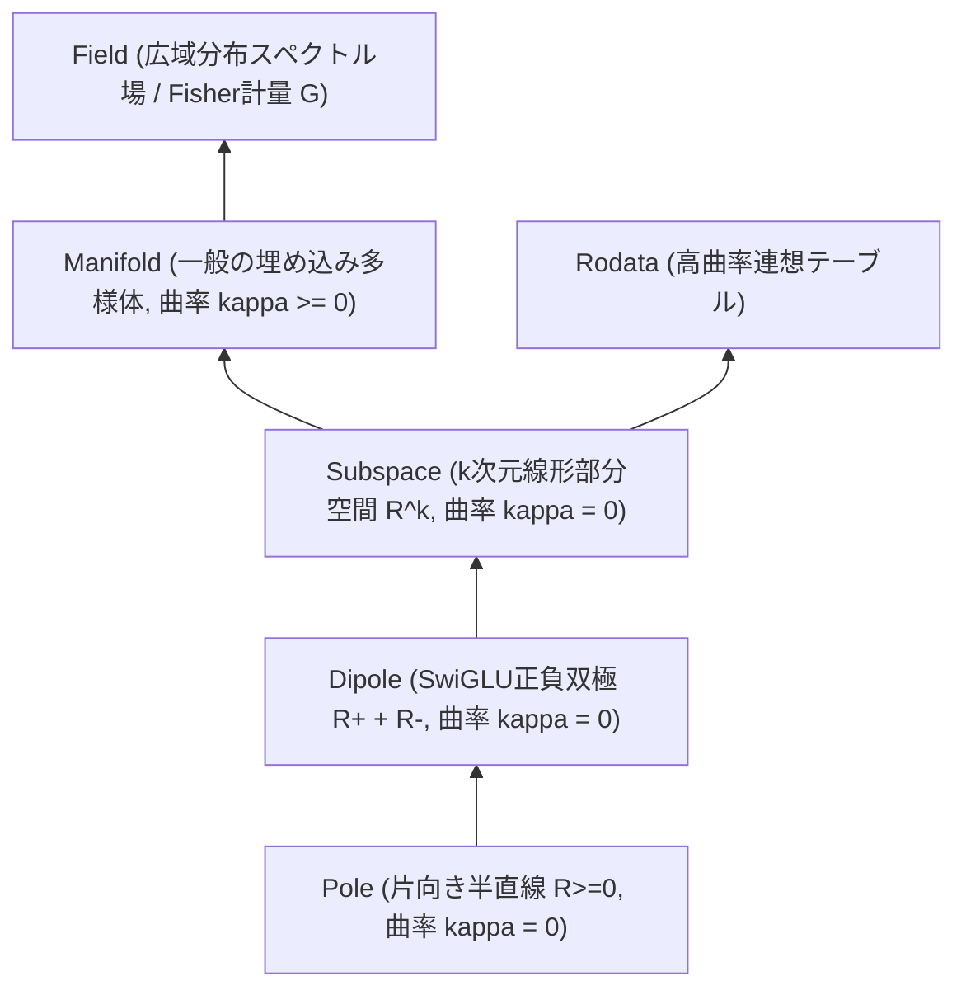

# 第2部：段階的多様体型システムと干渉・近似理論

重み空間における典型的なバグは、(1) 片向きの特徴（`Pole`）を負方向へ振ってノイズを生む、(2) 浅層と深層で座標基底が回転している特徴同士をそのまま足し合わせる、(3) 意図せず別の知識・推論能力へ干渉（クロストーク）する、(4) 曲がった意味空間（円環や階層構造）を単一平面として誤って扱う、という**幾何学的・座標系的ミスマッチ**に起因する。

本仕様書では、これらをコンパイル時に静的に検出・阻止する **`Strata` の段階的多様体型システム（Gradual Geometric Type System）**、**層座標系 `Frame<Stage>`**、および Rust の借用チェッカに相当する **干渉・近似エフェクト体系**を形式定義する。

---

## 1. 段階的幾何学型階層（Gradual Geometric Types）

`Strata` の型システムは、直感的な平坦表現から非線形多様体・巨視的スペクトル場までを統一的な部分型束（Subtyping Lattice）として階層化する。これにより、単純な構造に対しては一切の近似誤差ゼロ（$\delta = 0$）と最小限の記法を保証しつつ、必要に応じて曲がった多様体や連続暗黙知場へシームレスに拡張できる。



### 1.1 ミクロ幾何学型（`.text` の構成要素）

任意の層座標系 $f \in \text{Frame}$ における表現空間を $\mathcal{H}_f \cong \mathbb{R}^d$ とする。

1. **`Pole`（単極半直線型）**
   - **定義**: 単位方向ベクトル $\hat{e} \in \mathcal{H}_f$（$\|\hat{e}\|_2 = 1$）の非負定数倍で張られる1次元閉半直線（凸錐）：
     $$C(\hat{e}) = \{ \lambda \hat{e} \mid \lambda \in \mathbb{R}_{\ge 0} \} \subset \mathcal{H}_f$$
   - **幾何不変量**: 次元 $k = 1$、曲率 $\kappa = 0$、最小近似誤差 $\delta = 0$。
   - **物理的意味**: 「負の向きに反転すると意味を持たない単一方向特徴」（例：異常ループの活性、特定の拒絶検出）。型システムは `Pole` に対する無条件な負ゲイン励起（例：`gain: -1.0`）を拒絶し、逆位相対消滅（`-|`）または `when` ガード下での打ち消しのみを許す。

2. **`Dipole`（SwiGLU双極型）**
   - **定義**: 共通の基底軸を共有しつつ、異なる意味的役割を担う正極 $p_+ = (+pole)$ と負極 $p_- = (-pole)$ のペア：
     $$D(\hat{e}) = C(+\hat{e}) \cup C(-\hat{e}), \quad D.+pole : \text{Pole}, \quad D.-pole : \text{Pole}$$
   - **幾何不変量**: 埋め込み次元 $1$（2極構造）、曲率 $\kappa = 0$、誤差 $\delta = 0$。
   - **物理的意味**: Goodfire が見出した SwiGLU ニューロン極の直截な型表現。`D.+pole` を `-|` で抑えつつ `D.-pole` を `+>` で励起する操作は、単一SwiGLUニューロン列またはランク1対極パッチで厳密に表現できる。

3. **`Subspace<k>`（$k$ 次元線形部分空間型）**
   - **定義**: 正規直交基底 $U \in \mathbb{R}^{d \times k}$（$U^\top U = I_k$）によって張られる $k$ 次元平坦部分空間：
     $$S = \text{span}(U) \subset \mathcal{H}_f$$
   - **幾何不変量**: 次元 $k$、リーマン曲率および第二基本形式 $\kappa = 0$、誤差 $\delta = 0$。
   - **物理的意味**: 回転や線形写像が全体で意味を保つ部分空間（例：空間方位、文法的な数・格、2次元複素位相空間）。`Subspace<k>` 間の線形写像は1個の `ATTN_BILINEAR` または $k$ 個の線形パスとしてテッセレーションなしで厳密にコンパイルされる。

4. **`Manifold<Topo, k>`（一般埋め込み多様体型）**
   - **定義**: トポロジー種別 `Topo`（例：`S1` 円環、`T<m>` トーラス、`Tree` 双曲階層、`Simplex<m>`、`Free`）と固有次元 $k$ を持つ可微分（または区分滑らか）部分多様体 $M \hookrightarrow \mathcal{H}_f$。以下の幾何組 $(M, \mathcal{A}_M, TM, N_\epsilon(M), \kappa_M)$ を型情報として保持する：
     - **チャート・アトラス $\mathcal{A}_M = \{(U_i, \varphi_i)\}_{i \in I}$**: 各局所近傍 $U_i \subset M$ からローカル座標 $\varphi_i: U_i \to \mathbb{R}^k$ への同相写像。
     - **接束 $TM$**: 各点 $p \in M$ 上の接空間 $T_p M \subset \mathcal{H}_f$（`+>` による励起・輸送はこの接空間に沿う必要がある）。
     - **法束と管状近傍（Tubular Neighborhood） $N_\epsilon(M)$**: 多様体からの法線方向距離 $\epsilon$ 以内の許容近傍。クロストーク検証の幾何学的基盤となる。
     - **曲率上界 $\kappa_M$**: 多様体上の測地線と埋め込み空間 $\mathbb{R}^d$ のズレを表す第二基本形式の上界 $\| \text{II}_M \|_\infty \le \kappa_M$。

### 1.2 部分型包含関係（Subtyping Rules）

曲率ゼロのすべての幾何学型は、一般多様体の特殊ケースとして自然に上位型へ埋め込まれる（Gradual Lifting）：

$$
\text{Pole} \prec: \text{Subspace}\langle 1 \rangle \quad (\text{方向錐制約を伴う部分空間})
$$
$$
\text{Dipole} \prec: \text{Subspace}\langle 1 \rangle
$$
$$
\text{Subspace}\langle k \rangle \prec: \text{Manifold}\langle \text{Euclidean}, k \rangle \quad (\text{with } \kappa = 0, \delta = 0)
$$

したがって、通常の平らな特徴や双極だけを扱うプログラムでは多様体テッセレーションのオーバーヘッドが一切発生せず（$\delta = 0$ 静的証明）、`S1` や `T<2>` のような曲がった多様体が現れた箇所でのみコンパイラが自動的にアトラス分割を発動する。

### 1.3 マクロ暗黙知型 `Field<Spectrum>` と連想記憶型 `Rodata<K, V>`

1. **`Field<Spectrum>`（巨視的連続スペクトル場型）**:
   - 単一層の点ではなく、層区間 $S = [l_1, l_2]$ にわたるパラメータテンソル空間 $\mathcal{W}_S = \prod_{l \in S} \mathbb{R}^{d_{\text{out}}^{(l)} \times d_{\text{in}}^{(l)}}$ 内の分布的・低ランク／帯域スペクトル構造 $F = \{ (\Delta W_l, \Sigma_l, G_l) \}_{l \in S}$ を表す型。
   - ここで $G_l$ はキャリブレーション分布上のFisher情報計量（または活性化共分散計量）であり、`decouple`・`temper`・`blend` はすべてこの計量空間上で型付けされる。
   - `Spectrum` パラメータには `LowCurvature`（推論流暢性・スタイル）、`Mixed`、`All` などを指定可能（省略時はモデル非依存の連続場）。

2. **`Rodata<K, V>`（高曲率連想テーブル型）**:
   - 損失曲率 $\lambda(H) \ge \lambda_{\text{mem}}$ を持つ鋭敏なキー値写像。型引数 `K`, `V` はキー多様体・値多様体（または既定のトークン／エンティティ空間型）を指定する。

---

## 2. 層座標系型（`Frame<Stage>`）と接続安全性

Transformer の各層は同じ次元 $\mathbb{R}^d$ を共有しているが、意味的座標基底は深度に応じて絶えず回転・変形している（例：浅層の構文的表現と深層の次トークン予測表現はそのまま加算できない）。この座標混同を静的に防ぐため、すべての幾何学型は**層座標系タグ `Frame<Stage>`** に紐付けられる。

### 2.1 `Frame` の階層と段階区間

標準組み込みの段階（Stage）は正規化深度 $s \in [0, 1]$ の区間として定義される：
- `Frame<Early>`: $s \in [0.00, 0.25)$（語彙・局所構文エンコーディング）
- `Frame<Mid>`: $s \in [0.25, 0.75)$（関係推論・多段合成・記憶参照）
- `Frame<Late>`: $s \in [0.75, 0.95)$（仮説統合・検証・出力準備）
- `Frame<Logit>`: $s \in [0.95, 1.00]$（語彙アンエンベディング直前）
- `Frame<All>`: $[0.00, 1.00]$（全層横断；主に広域 `Field` や残差保護対象に用いる）
- 数値範囲指定 `Frame<10..15>` やユーザー定義 `frame CustomMid in Mid;` も許容される。

### 2.2 接続写像（Connection）と平行移動（Parallel Transport）

2つの異なるフレーム $f_1, f_2$ の間に、事前解析（`.natlas`）または `anchor` 探索によって線形／区分滑らかな接続写像（Parallel Transport） $\nabla_{f_1 \to f_2}: \mathcal{H}_{f_1} \to \mathcal{H}_{f_2}$ が存在するとき、これを用いて一方の幾何オブジェクトを他方の座標系へ持ち上げることができる。

- **明示的輸送構文**: `transport(expr, Frame<Early> -> Frame<Mid>)`
- **区間包含サブタイピング**: $S_1 \subseteq S_2$ のとき、`Frame<S1>` から `Frame<S2>` への制限または共通部分 $S_1 \cap S_2 \ne \emptyset$ 上での合成は合法。
- **静的エラー**: 互いに素なフレーム（例：`Frame<Early>` と `Frame<Late>`）上の要素を `transport(...)` も接続証明もなしに `+>`・`-|`・`=>` で直接合成しようとした場合、コンパイラは **`FrameMismatchError`** を送出してコンパイルを拒否する。

---

## 3. 干渉・近似エフェクト体系（重み空間の借用チェッカ）

Rust がメモリ安全性を所有権とライフタイムで静的に検証するように、`Strata` は重み空間の安全性を**エフェクト契約 `![...]`** によって静的に検証する。

`flow` 宣言に付与される契約は次の4要素からなる（省略時はモジュール既定値が適用される）：

```text
![crosstalk <= 1e-3, approx <= 1e-2, energy <= 0.15, preserve(CoreFluency, Residual)]
```

### 3.1 管状近傍クロストーク境界（`crosstalk <= ε`）

介入作用素 $\Delta$ が保護対象集合 $\mathcal{P} = \{P_1, P_2, \dots, P_m\}$ に対して引き起こす干渉度 $\chi(\Delta, \mathcal{P})$ を定義する。

1. **ミクロ幾何型同士のクロストーク（`.text` / `.rodata`）**:
   介入の出力部分空間（または書き込み方向群の単位基底 $U_\Delta$）と保護対象多様体の接空間 $T P_j$（および管状近傍 $N_\epsilon(P_j)$）の主角度の余弦（最大特異値）で評価する：
   $$
   \chi_{\text{micro}}(\Delta, P_j) := \sup_{u \in \text{Im}(\Delta) \setminus \{0\}, \, v \in T P_j \setminus \{0\}} \frac{|\langle u, v \rangle|}{\|u\|_2 \|v\|_2} = \| U_\Delta^\top U_{P_j} \|_2
   $$
   ただし、保護対象が `Residual`（2〜4%の未分類残差基底 $B_{\text{res}}$）を含む場合、コンパイラは $\text{Im}(\Delta) \perp_\epsilon B_{\text{res}}$ を強制する。

2. **マクロ場 `Field` のクロストーク（`.field`）**:
   場 $F_{\text{edit}}$ が保護対象場 $F_{\text{keep}}$ に与える干渉は、Fisher情報行列 $G$ による重み付きFrobenius内積で評価する：
   $$
   \chi_{\text{field}}(F_{\text{edit}}, F_{\text{keep}}) := \frac{|\langle F_{\text{edit}}, F_{\text{keep}} \rangle_G|}{\|F_{\text{edit}}\|_G \, \|F_{\text{keep}}\|_G}
   $$
   `decouple` 演算子は、定義上 $\chi_{\text{field}}(F_1 \mathbin{\text{decouple}} F_2, F_2) \le \epsilon_{\text{reg}}$ を満たす出力型を生成する（第4部アルゴリズム3で定式化）。

### 3.2 曲率テッセレーション近似境界（`approx <= δ`）

曲がった多様体 $M$ 上の非線形写像 $\Phi: M \to N$ を、Transformerの線形AttentionとSwiGLU区分線形MLPだけで実現する際、避けられない幾何学的近似誤差が発生する。この誤差上界 $\delta_{\text{comp}}$ を型レベルで追跡する：

- **平坦型の公理**: $\text{type}(\Phi) \in \{\text{Pole}, \text{Dipole}, \text{Subspace}\langle k \rangle\} \implies \delta_{\text{comp}} = 0$。
- **多様体写像のテッセレーション則**: 曲率上界 $\kappa$、写像のリプシッツ定数 $L_\Phi$ の変換を $K$ 枚の局所チャートポリトープへ展開するとき、誤差上界 $\delta(K) \le \frac{L_\Phi^2 \kappa \cdot h^2}{8}$ が導出される（$h$ は各チャートの測地線半径）。
- 必要なチャート数 $K$ を確保して $\delta_{\text{total}} \le \delta$ を満たせない場合（例：`--target=in-place` で空きニューロンが不足）、コンパイラは **`ApproximationUnmetError`** を出し、サイレントな精度劣化を許さない。

### 3.3 エフェクト結合則（Composition Algebra）

順次実行 $e_1 ; e_2$ に対して、エフェクト組 $\langle \epsilon, \delta, \eta \rangle$ は以下の半環則に従って合成される（ここで $\eta$ は第1部4節で定めた正規化エネルギー消費比）：

$$
\langle \epsilon_1, \delta_1, \eta_1 \rangle \oplus \langle \epsilon_2, \delta_2, \eta_2 \rangle = \langle \max(\epsilon_1, \epsilon_2),\; L_2 \delta_1 + \delta_2,\; \eta_1 + \eta_2 \rangle
$$

ここで $L_2$ は後段変換 $e_2$ のリプシッツ定数である。合成後の全エフェクトは `flow` ヘッダの契約 $\langle \epsilon_{\max}, \delta_{\max}, E_{\max} \rangle$ と比較検査される。

---

## 4. 形式的型付け判断規則（Typing Judgments）

型環境 $\Gamma$（シンボルから型・フレーム・保護属性への写像）、現在の文脈フレーム $f$、効果コンテキスト $\mathcal{E} = \langle \epsilon, \delta, \eta, \mathcal{P} \rangle$ の下での式の型付け判断を次のように表記する：

$$
\Gamma;\; f \vdash e : \tau \mathbin{!} \langle \epsilon, \delta, \eta \rangle
$$

主要構文に対する推論規則を以下に定める。

### 規則 [T-Pole] / [T-Dipole]（極アクセス）
$$
\frac{
  (D : \text{Dipole} \mathbin{@} f_D) \in \Gamma \quad f_D \cap f \ne \emptyset \quad \text{pol} \in \{+\text{pole}, -\text{pole}\}
}{
  \Gamma;\; f \vdash D.\text{pol} : \text{Pole} \mathbin{@} (f_D \cap f) \mathbin{!} \langle 0, 0, 0 \rangle
}
$$

### 規則 [T-Transport-Frame]（層座標系間の平行移動）
$$
\frac{
  \Gamma;\; f_1 \vdash e : \tau \mathbin{@} f_1 \mathbin{!} \langle \epsilon, \delta, \eta \rangle \quad
  \exists \nabla_{f_1 \to f_2} \in \text{Atlas}(\Gamma) \text{ with error } \delta_\nabla
}{
  \Gamma;\; f_2 \vdash \text{transport}(e, f_1 \to f_2) : \tau \mathbin{@} f_2 \mathbin{!} \langle \epsilon, \delta + \delta_\nabla, \eta \rangle
}
$$

### 規則 [T-Excite]（励起 `+>`）
`Pole` 型に対する負のゲイン励起を禁止し、フレーム一致・クロストーク・エネルギーを検証する：
$$
\frac{
  \Gamma;\; f \vdash s : \text{Residual} \mathbin{@} f_s \quad
  \Gamma;\; f \vdash v : \tau \mathbin{@} f_v \quad
  \tau \prec: \text{Manifold} \lor \tau = \text{Field} \quad
  f_s \cap f_v \ne \emptyset \\
  (\tau = \text{Pole} \implies \alpha \ge 0) \quad
  \chi(v, \mathcal{P}) \le \epsilon_0 \quad
  \eta_v = \frac{\alpha^2 \|v\|^2}{\bar{E}_{f_s}}
}{
  \Gamma;\; f \vdash (s \mathbin{+>} v(\text{gain}: \alpha)) : \text{Unit} \mathbin{!} \langle \epsilon_0, \delta_v, \eta_v \rangle
}
$$

### 規則 [T-Annihilate]（対消滅 `-|`）
対象 $M$（`Pole`, `Dipole`, `Subspace`, `Manifold`, `Field` のいずれか）の直交射影成分を差し引く。正のスカラー `scale` を要求し、`Pole` に対しても安全にゼロ切断射影を行う：
$$
\frac{
  \Gamma;\; f \vdash s : \text{Residual} \mathbin{@} f_s \quad
  \Gamma;\; f \vdash M : \tau \mathbin{@} f_M \quad
  f_s \cap f_M \ne \emptyset \quad
  \beta \ge 0 \quad
  \chi(\Pi_M, \mathcal{P}) \le \epsilon_0
}{
  \Gamma;\; f \vdash (s \mathbin{-|} M(\text{scale}: \beta)) : \text{Unit} \mathbin{!} \langle \epsilon_0, 0, \eta_\Pi \rangle
}
$$

### 規則 [T-When]（共鳴ゲート付きブロック）
`when` ガードによる局所チャート共鳴を前提とし、本体ブロック内では共鳴対象チャート $U_{\text{tgt}}$ 上での近似・励起が許される（未共鳴領域への不要な書き込みゼロを保証）：
$$
\frac{
  \Gamma;\; f \vdash x : \text{Residual} \mathbin{@} f_x \quad
  \Gamma;\; f \vdash T : \tau_T \mathbin{@} f_T \quad
  f_x \cap f_T \ne \emptyset \\
  \Gamma, (\text{bind} : \text{ChartCoord}(\tau_T));\; (f \cap f_T) \vdash \text{blk} : \text{Unit} \mathbin{!} \langle \epsilon, \delta, \eta \rangle
}{
  \Gamma;\; f \vdash (\text{when } x \mathbin{\sim>} T(\dots)\; [\text{as } \text{bind}]\; \text{blk}) : \text{Unit} \mathbin{!} \langle \epsilon, \delta, \eta \rangle
}
$$

### 規則 [T-Manifold-Map]（多様体間の輸送 `=>`）
平坦空間同士（$\kappa_1 = \kappa_2 = 0$）なら誤差ゼロ、曲率を持つ場合は許容誤差 $\delta_{\text{req}}$ 以内でテッセレーション可能であることを要求する：
$$
\frac{
  \Gamma;\; f \vdash e : \tau_1 \mathbin{@} f_1 \mathbin{!} \langle \epsilon_1, \delta_1, \eta_1 \rangle \quad
  \Gamma;\; f \vdash \Phi : (\tau_1 \to \tau_2) \mathbin{@} f_2 \quad
  f_1 \cap f_2 \ne \emptyset \quad
  \delta_{\text{tess}}(\Phi) \le \delta_{\text{budget}}
}{
  \Gamma;\; (f_1 \cap f_2) \vdash (e \mathbin{=>} \Phi) : \tau_2 \mathbin{@} (f_1 \cap f_2) \mathbin{!} \langle \epsilon_1, L_\Phi \delta_1 + \delta_{\text{tess}}(\Phi), \eta_1 + \eta_\Phi \rangle
}
$$

### 規則 [T-Attend]（非局所関係場 `@attend`）
トークン間で参照するクエリ・キー表現のフレーム一致および因果マスク整合性を検査する：
$$
\frac{
  \Gamma;\; f \vdash q : \tau_Q \mathbin{@} f_a \quad
  \Gamma;\; f \vdash K : \tau_K \mathbin{@} f_a \quad
  \Gamma;\; f \vdash V : \tau_V \mathbin{@} f_a \quad
  \text{CompatibleBilinear}(\tau_Q, \tau_K)
}{
  \Gamma;\; f \vdash @\text{attend}(\text{query}: q, \text{key}: K, \text{value}: V, \dots) : \tau_V \mathbin{@} f_a \mathbin{!} \langle \epsilon_{\text{attn}}, 0, \eta_{\text{attn}} \rangle
}
$$

### 規則 [T-Field-Decouple]（巨視的連続場の直交分離 `decouple`）
2つの暗黙知場 $F_1, F_2$ から、$F_2$ に対してFisher直交保証付きの純粋場を生成する。生成された場 $F_{\text{pure}}$ を用いた介入は $F_2 \in \mathcal{P}$ の保護契約を自動的に満たす証拠（Witness）を保持する：
$$
\frac{
  \Gamma;\; f \vdash F_1 : \text{Field}\langle S_1 \rangle \mathbin{@} f_1 \quad
  \Gamma;\; f \vdash F_2 : \text{Field}\langle S_2 \rangle \mathbin{@} f_2 \quad
  f' = f_1 \cap f_2 \ne \emptyset
}{
  \Gamma;\; f \vdash (F_1 \mathbin{\text{decouple}} F_2) : \text{Field}\langle S_1 \mid \perp F_2 \rangle \mathbin{@} f' \mathbin{!} \langle \epsilon_{\text{reg}}, 0, 0 \rangle
}
$$

### 規則 [T-Rodata-Op]（高曲率記憶テーブル更新）
`.rodata` の書き換え操作が `.text`（低曲率計算回路）および保護リスト $\mathcal{P}$ へ与えるクロストークが $\epsilon_0$ 以下であることを検査する：
$$
\frac{
  (R : \text{Rodata}\langle K, V \rangle \mathbin{@} f_R) \in \Gamma \quad
  \chi_{\text{rodata}}(R, \text{TextCircuits} \cup \mathcal{P}) \le \epsilon_0
}{
  \Gamma;\; f \vdash (\text{rewrite}|\text{insert}|\text{prune})\; R(\dots) : \text{Unit} \mathbin{!} \langle \epsilon_0, 0, \eta_{\text{mem}} \rangle
}
$$

---

## 5. 型エラーとコンパイラ診断の一覧

| 静的エラー名 | 発生条件 | 解決策の例 |
| :--- | :--- | :--- |
| **`FrameMismatchError`** | 異なる層座標（例：`Early` と `Late`）を接続写像なしで演算 | `transport(x, Frame<Early> -> Frame<Mid>)` を挿入 |
| **`UnipolarViolationError`** | `Pole` 型に対して負方向への直接励起（`gain < 0`）を指定 | 対消滅 `-|` を使用するか、両極意味を持つ `Dipole` / `Subspace<1>` として宣言 |
| **`CrosstalkExceededError`** | 介入が `preserve(...)` 対象へ許容 `ε` 以上の内積／Fisher干渉を起こす | Nullspace射影強度の引き上げ、または `decouple` による事前の直交分離 |
| **`ApproximationUnmetError`** | 曲率 $\kappa > 0$ の多様体写像を許容誤差 `δ` 以内に展開できない | `--target=elastic` への切り替え、または `approx` 許容値の緩和 |
| **`EnergyBudgetExceededError`** | RMSNormバジェット `energy <= E` を超過しNorm Dilutionの恐れあり | `gain` / `scale` の縮小、あるいは対向極への等エネルギー補償 |
