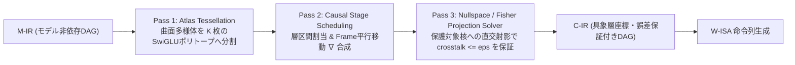

# 第4部：中間表現（M-IR / C-IR）・重み空間ISA・コード生成

本仕様書では、`Strata` ソースコードを物理モデルの重み更新（`.safetensors` 差分または増築テンソル）へと変換するコンパイラバックエンドの全体系——**M-IR（多様体中間表現）**、**C-IR（回路・ポリトープ中間表現）と3大最適化パス**、**W-ISA（重み空間命令セットアーキテクチャ）**、および **`--target=in-place` / `--target=elastic` デュアルコード生成アルゴリズム**を定義する。

---

## 1. M-IR（Manifold Intermediate Representation）

**M-IR** は、ターゲットモデルの層数 $L$・隠れ次元 $d$・MLP幅 $d_{\text{ff}}$・Attention方式（MHA/GQA/MLA）から完全に切り離された、**モデル非依存の型付きSSAデータフローDAG**である。クロスコンパイル（第5部）はすべてこのM-IRレベルを不変の中継点として実行される。

### 1.1 M-IR の3領域構造

M-IR モジュールは以下の3セクションのグラフノード集合として表現される：

1. **`.text` フローグラフ（Micro Circuit DAG）**:
   - `ResonanceGate(x, chart_ref, threshold)`：多様体チャート／極への共鳴検出ノード
   - `TangentExcite(x, dir_ref, gain)`：接空間方向への励起ノード
   - `ProjAnnihilate(x, subspace_ref, scale)`：射影対消滅ノード
   - `ManifoldMap(x, phi_spec, kappa_bound, delta_budget)`：多様体間輸送ノード（まだポリトープ分割されていない連続写像）
   - `RelationalGather(q, k_manifold, v_manifold, mask)`：`@attend` の抽象非局所ノード
   - `FrameBridge(x, src_frame, dst_frame)`：平行移動 $\nabla$ の挿入点

2. **`.rodata` テーブル操作リスト（Associative Patch List）**:
   - `RodataMutate(table_ref, op in {INSERT, PRUNE, REWRITE}, key_anchor, val_anchor, sharpness)`

3. **`.field` スペクトル演算DAG（Macro Field DAG）**:
   - `FieldBind(field_ref, stage_span)`
   - `FieldDecouple(f_target, f_protect, metric in {FISHER, COV})`
   - `FieldTemper(f_target, curvature_band, scale_curve)`
   - `FieldBlend(f_a, f_b, alpha, manifold_metric)`
   - `FieldApply(state_span, field_node, scale)`

```mir
// M-IR テキストダンプ形式の例
mir.module @SafetyAndReasoningPatch {
  mir.contract { crosstalk <= 1e-3, approx <= 1e-2, energy <= 0.15, preserve = [@CoreFluency, @Residual] }

  %g0 = mir.resonance %state, @MathLoopAnomaly.+pole, threshold=0.72 : Pole in Frame<Mid..Late>
  mir.gated_region %g0 {
    mir.annihilate %state, @MathLoopAnomaly.+pole, scale=1.0
    mir.excite     %state, @MathLoopAnomaly.-pole, gain=0.45
  }

  %f0 = mir.field.decouple @SycophancyDrift, @EmpatheticTone, metric=FISHER
  mir.field.apply %state, %f0, scale=-0.80
}
```

---

## 2. C-IR（Circuit & Polytope IR）と3大コンパイラパス

**C-IR** は、ターゲットモデルの幾何構造（`.natlas` とハイパーパラメータ $(L, d, d_{\text{ff}}, H_q, H_{kv})$）を受け取り、抽象的な M-IR を**区分線形ハードウェア演算・層区間・直交射影済み行列差分**へと具象化する中間表現である。



### 2.1 パス1：Atlas Tessellation Pass（曲面多様体の区分線形展開）

曲率 $\kappa_M = 0$ の型（`Pole`, `Dipole`, `Subspace<k>`）はテッセレーションを一切行わず 0 誤差（$\delta = 0$）で素通りする。曲率 $\kappa_M > 0$ を持つ多様体写像 $\Phi: M \to N$（例：円環 $S^1$ 上の回転）に対してのみ、以下のアルゴリズムを実行する。

#### アルゴリズム1：曲率適応型チャート分割とSwiGLUバンプ展開

1. **チャート数 $K$ の決定**:
   多様体 $M$ の測地線単位接線に沿った写像の2階微分上界 $M_2 \ge \sup_{\gamma} \| \frac{d^2}{dt^2} \Phi(\gamma(t)) \|_2$（曲率 $\kappa_M$ とリプシッツ定数 $L_\Phi$ に比例）と、効果契約の許容誤差 $\delta$ から、各チャートの最大測地線半幅 $h$ を決定する：
   $$
   h \le \sqrt{\frac{2\delta}{M_2}}, \qquad K = \left\lceil \frac{\text{Vol}_1(M)}{2 h} \right\rceil \quad (\text{1次元 } S^1 \text{ なら } \text{Vol}_1 = 2\pi R \implies K = \left\lceil \pi R \sqrt{\frac{M_2}{2\delta}} \right\rceil)
   $$
   一般の $k$ 次元コンパクト多様体では $\varepsilon$-ネット被覆により $K = O\!\left((M_2 / \delta)^{k/2}\right)$ 個のチャート中心 $\{c_j\}_{j=1}^K \subset M$ を生成する。

2. **SwiGLU $C^1$ チャートゲート（非バイアス型残差互換）の構築**:
   各チャート中心 $\hat{c}_j = c_j / \|c_j\|_2$ と近傍余弦閾値 $\tau_j = \cos(\Delta\theta)$ に対し、定数／正規化アンカー軸 $e_0$（$\langle e_0, x \rangle = 1$ を供給する座標、またはバイアス項）を用いて正規化距離 $z_j(x) = \frac{\langle \hat{c}_j, x \rangle - \tau_j \langle e_0, x \rangle}{1 - \tau_j}$ を定義し、ゲートおよびアップ射影ベクトルを定める：
   $$
   w_{\text{gate}, j} = \beta \, z_j, \qquad w_{\text{up}, j} \parallel z_j \quad (\text{または局所接線基底})
   $$
   ここで急峻度 $\beta \gg \delta^{-1}$ と選ぶことで、$\text{SiLU}(z)$ 特有の負側の谷（最小値 $-0.2785/\beta$）による領域外リークを $\delta$ 未満へ抑え込み、かつ $w_{\text{up}, j}$ にも $z_j$ 因子を含めることでチャート境界 $z_j = 0$ において値と1階微分の両方がゼロとなる **$C^1$ 滑らかな2次SwiGLUスプライン基底** $(\text{ReLU}(z_j))^2 \approx \frac{1}{\beta}\text{SiLU}(\beta z_j)\cdot z_j$ を形成する（境界の折れ点振動を排除）。

3. **局所接線書き込み行列の最小二乗フィッティング**:
   残差更新目標 $\Delta\Phi(x) = \Phi(x) - x$ を再現するため、各シフトチャートスロット $s$ の出力方向ベクトル $w_{\text{down}, s} \in \mathbb{R}^d$ を、サンプル点 $\{x_m\} \subset M$ 上の基底展開：
   $$
   \hat{\Delta}(x) = \sum_{s} \left( \text{SiLU}(w_{\text{gate}, s}^\top x) \cdot (w_{\text{up}, s}^\top x) \right) w_{\text{down}, s}
   $$
   において $\sup_{x \in M} \| \Delta\Phi(x) - \hat{\Delta}(x) \|_2 \le \delta$ を満たすよう線形連立方程式（または低ランクSVD分解）で解く。

4. **精密性検証**:
   検証後の最大誤差 $\hat{\delta}_{\text{max}}$ が契約 $\delta$ を超過する場合、$K$ を倍増して再試行する。ターゲット容量（`--target=in-place` の空き極数）を超過した場合は `ApproximationUnmetError` を報告する。

---

### 2.2 パス2：Causal Stage Scheduling & Frame Connection Synthesis

1. **トポロジカル層割り当て**: M-IR DAG の各ノードに対し、`@stage` アノテーションおよび `Frame<Stage>` 制約を統合した区間 $[l_{\min}(v), l_{\max}(v)]$ を計算し、ASAP / ALAP スケジューリングにより物理層番号 $l(v)$ を決定する。Attention（`@attend`）とMLP（`when` / `=>`）の交互実行則 $l_{\text{MLP}} \ge l_{\text{Attn}}$（同一層内はAttention先行）を遵守する。
2. **平行移動の挿入**: エッジ $(u \to v)$ 間で $f(u) \ne f(v)$ かつ `.natlas` に線形接続 $T_{u \to v}$ が存在するとき、中間に `VPD_RANK1` による基底回転補正を自動挿入する。

---

### 2.3 パス3：Nullspace & Fisher-Orthogonal Projection Solver

エフェクト契約 `![crosstalk <= eps, preserve(P_1, ..., P_m)]` を物理重み空間で数学的に保証する中核ソルバである。

#### アルゴリズム3A：ミクロ回路用 Nullspace 射影（`.text` / `.rodata`）

保護対象集合 $\mathcal{P}$ に属する特徴・回路および `.residual` 保護基底が張る正規直交行列（または活性化共分散行列 $K_{\mathcal{P}} \in \mathbb{R}^{r \times d}$）を入力とする。生の重み更新行列 $\Delta W_{\text{raw}} \in \mathbb{R}^{d_{\text{out}} \times d_{\text{in}}}$ に対し、出力方向保護（左Nullspace）および入力読み取り保護（右Nullspace）の同時制約を次のように解く：

- **入力保護（不要な活性パターンで発火させない）**:
  保護活性キー行列 $K_{\mathcal{P}}$ に対する正則化射影演算子：
  $$
  P_{\text{in}}^{\perp} = I_{d_{\text{in}}} - K_{\mathcal{P}}^\top \left( K_{\mathcal{P}} K_{\mathcal{P}}^\top + \lambda I \right)^{-1} K_{\mathcal{P}}
  $$
- **出力保護（保護特徴の方向へ書き込まない）**:
  保護出力特徴の正規直交基底 $U_{\mathcal{P}} \in \mathbb{R}^{d \times r_{\text{out}}}$ に対する直交補空間射影：
  $$
  P_{\text{out}}^{\perp} = I_{d_{\text{out}}} - U_{\mathcal{P}} U_{\mathcal{P}}^\top
  $$
- **射影済み最終重み差分**:
  $$
  \Delta W_{\text{safe}} = P_{\text{out}}^{\perp} \, \Delta W_{\text{raw}} \, P_{\text{in}}^{\perp}
  $$
  ここで $\lambda \to 0$（特異値閾値打ち切り）の極限において $U_{\mathcal{P}}^\top \Delta W_{\text{safe}} = 0$ および $\Delta W_{\text{safe}} K_{\mathcal{P}}^\top = 0$ が成立し、クロストーク $\chi \le \epsilon$ が保証される。

#### アルゴリズム3B：マクロ場用 Fisher 直交分離（`.field` の `decouple`）

2つの連続暗黙知場 $F_1, F_2 \in \mathbb{R}^{d_{\text{out}} \times d_{\text{in}}}$（ランク $r_1, r_2$ のスペクトル展開 $F_2 = \sum_{i=1}^{r_2} \sigma_i a_i b_i^\top$）および経験的 Fisher 情報計量 $G = \text{diag}(G_{\text{row}}) \otimes \text{diag}(G_{\text{col}})$（または活性化共分散重み行列 $G$）のもとで、`F1 decouple F2` を計算する。

$F_2$ の基底成分を計量内積 $\langle X, Y \rangle_G := \text{Tr}(X^\top G_{\text{out}} Y G_{\text{in}})$ に従って Gram-Schmidt 直交化し、正規直交スペクトル基底 $\{ E_j \}_{j=1}^{r_2}$（$\langle E_i, E_j \rangle_G = \delta_{ij}$）を構成する。このとき直交分離された純粋場は次の閉形式で一意に与えられる：

$$
F_{\text{pure}} = F_1 - \sum_{j=1}^{r_2} \langle F_1, E_j \rangle_G \, E_j
$$

この出力 $F_{\text{pure}}$ は厳密に $\langle F_{\text{pure}}, F_2 \rangle_G = 0$ を満たすため、後続の `state -| F_pure(scale: alpha)` は保護対象 $F_2$（例：共感性・流暢性）に対する1次摂動をゼロに保つ。

---

## 3. W-ISA（Weight-Space Instruction Set Architecture）

W-ISA は、Transformer の物理テンソルとAIC拡張テンソルに対する **7つの原子命令**からなる低水準命令セットである。

| W-ISA 命令 | オペランド | 物理テンソルへの作用と下位変換則 |
| :--- | :--- | :--- |
| **`SWIGLU_POLE`** | `(layer, slot, polarity, w_gate, w_up, w_down)` | 層 `layer` のSwiGLU第 `slot` ニューロンの正極または負極を書き換える（`elastic` 時は末尾 `slot` を新規追加）。`gate_proj[slot] += w_gate`, `up_proj[slot] += w_up`, `down_proj[:, slot] += polarity * w_down`。 |
| **`THRESHOLDED_ROUTE`** | `(layer, slot, polarity, threshold, u, scale)` | SwiGLU活性 $a_j(x)$ に対し、$\Delta r=\text{scale}\,\mathbf{1}[\text{polarity}\,a_j(x)>\text{threshold}]\,\text{polarity}\,a_j(x)u$ を加える。AIC拡張テンソルを追加するためAICランタイム専用であり、LoRAターゲットでは拒否される。 |
| **`VPD_RANK1`** | `(layer, matrix_id, u, v, scale)` | 指定重み行列 $W \in \{W_{\text{down}}, W_O, \dots\}$ へランク1部品を追加・減算：$W \leftarrow W + \text{scale} \cdot u v^\top$。Nullspace射影後に発行される。 |
| **`ATTN_BILINEAR`** | `(layer, head_group, W_qk, W_ov, rope_mode)` | `@attend` を物理Attentionヘッド群へコンパイルする。MHA・GQA・MLAの差異をここで吸収する（3.1節参照）。 |
| **`ASSOC_MEM_ROW`** | `(layer, k_star, v_star, C_inv, target_norm)` | `.rodata` 連想記憶パッチ命令。共分散逆行列 $C^{-1}$ を用いた閉形式ランク1更新：<br>$\Delta W_{\text{down}} = \frac{(v_* - W_{\text{down}} k_*) (C^{-1} k_*)^\top}{(C^{-1} k_*)^\top k_*}$ |
| **`FIELD_SPECTRAL_OP`** | `(layer_range, U_k, V_k, coeff_delta)` | `.field` 命令。層区間 `layer_range` の重み群に対し、直交化・スペクトルフィルタ済み差分 $\sum_k \delta_k u_k v_k^\top$ を一括重畳する。 |
| **`NORM_RESCALE`** | `(layer, norm_id, gamma_scale)` | 励起後のNorm Dilutionを補償するため、RMSNormの $\gamma$ ベクトルを微小補正：$\gamma \leftarrow \gamma \odot (1 + \gamma_{\text{scale}})$。 |

### 3.1 `ATTN_BILINEAR` における MHA / GQA / MLA 吸収則

クロスコンパイルを現実のLLMで成立させるため、`ATTN_BILINEAR` は主要3種のAttentionアーキテクチャへの低下（Lowering）規則を備える：

1. **MHA（Multi-Head Attention）**:
   各ヘッド $h$ が独立した $(W_Q^{(h)}, W_K^{(h)}, W_V^{(h)}, W_O^{(h)})$ を持つため、抽象双線形項 $W_{QK} = (W_Q^{(h)})^\top W_K^{(h)}$ および $W_{OV} = W_O^{(h)} W_V^{(h)}$ へ直接SVD分解で書き下す。
2. **GQA（Grouped-Query Attention：Llama-3 / Qwen2.5〜3 等）**:
   1つのKVヘッド $g$ を $m = H_q / H_{kv}$ 個のQueryヘッド $\{h_1, \dots, h_m\}$ が共有する制約がある。コンパイラは対象KVヘッド $g$ の $W_K^{(g)}, W_V^{(g)}$ を共有保護対象とし、**同一グループ内の未使用Queryヘッドのみを用いて $W_Q^{(h_i)}$ と $W_O^{(h_i)}$ を編集**する。グループ内のすべてのQueryヘッドが保護対象で占有されている場合、`--target=in-place` では **`GQAHeadSharingConflictError`** を発出し、`--target=elastic` でのみKVヘッド複製または増設を許す。
3. **MLA（Multi-head Latent Attention：DeepSeek系等）**:
   圧縮潜在空間 $c_{KV} = W_{DKV} x \in \mathbb{R}^{d_c}$ を経由するため、読み取り方向を潜在基底へ吸収 $W_{QK}^{\text{eff}} = (W_{UQ} W_{DQ})^\top W_{UK} W_{DKV}$ として射影し、低ランクの潜在空間制約（$d_c$ 次元ボトルネック）を満たすことを静的検査する。

---

## 4. デュアルバックエンドコード生成（`in-place` vs `elastic`）

同一の C-IR と W-ISA から、コンパイラフラグに応じて2通りのバイナリ出力を選択できる。

### 4.1 `--target=in-place`（形状固定リノベーション）

通常命令はモデルの既存テンソル形状・層数を変えず、空き自由度へW-ISA命令をパッキングする。例外として`THRESHOLDED_ROUTE`はAIC拡張テンソルを追加し、`config.json`の`aic_threshold_routes`を有効にする。

1. **スロット割り当て優先順位**:
   - **(1) 休眠極・低寄与極の再利用**: `.natlas` 上でキャリブレーション発火頻度・因果帰属度が閾値 $\tau_{\text{dead}}$ 未満の SwiGLU スロット（Dead / Dormant Poles）を再利用。
   - **(2) VPD 低ランク余剰空間**: 重み行列の低寄与特異値方向・既存Nullspaceへの `VPD_RANK1` 注入。
   - **(3) 既存極の極性再利用**: 対象極と同一軸の反対極（`+pole` のみ使われ `-pole` が休眠中のスロット）の活用。
2. **静的容量超過エラー体系**:
   空き自由度が契約（`crosstalk <= eps`, `approx <= delta`）を満たせない場合、無言で性能を壊す代わりに以下の静的エラーを送出して中断する：
   - **`OutOfDepthError`**: 因果DAGのクリティカルパス長が指定層区間（例：`Frame<10..15>`）の物理層数を超過。
   - **`NullspaceExhaustedError`**: `preserve(...)` 集合の次元が大きく、$\chi \le \epsilon$ を満たす残余Nullspaceランクが不足。
   - **`ApproximationUnmetError`**: `--target=in-place` の空き SwiGLU 極数が、許容誤差 $\delta$ に必要なテッセレーションチャート数 $K$ を下回っている。
   - **`GQAHeadSharingConflictError`**: GQA共有KVヘッドの編集が同グループ内の保護ヘッドと衝突。

### 4.2 `--target=elastic`（恒等バイパス付きクリーン増築）

容量制約を超えた大規模回路や超高精度多様体（$\delta \to 0$）を無干渉で実装するため、テンソル形状の拡張を許可するバックエンド。

1. **SwiGLU MLP 幅拡張（$d_{\text{ff}} \to d_{\text{ff}} + m$）**:
   既存パラメータを一切書き換えず、新規 $m$ 個の極ブロックを連結する：
   $$
   W_{\text{gate}}' = \begin{bmatrix} W_{\text{gate}} \\ \Delta W_{\text{gate}} \end{bmatrix}, \quad
   W_{\text{up}}' = \begin{bmatrix} W_{\text{up}} \\ \Delta W_{\text{up}} \end{bmatrix}, \quad
   W_{\text{down}}' = \begin{bmatrix} W_{\text{down}} & \Delta W_{\text{down}} \end{bmatrix}
   $$
   増設ゲートは `when` のチャート近傍外で $\text{SiLU}(\Delta w_{\text{gate}}^\top x) \approx 0$ となるよう閾値初期化されるため、未関連入力に対する出力変化は指数関数的にゼロに抑えられる。
2. **恒等残差層挿入（Zero-Initialized Residual Bypass Layer）**:
   深さ不足（`OutOfDepthError` 回避）が必要な場合、指定層境界に新規Transformerブロックを挿入する。新設ブロック内の全出力投影行列（$W_O^{\text{new}} = 0, W_{\text{down}}^{\text{new}} = 0$ の残差ゼロ基盤の上にコンパイル済み回路の $\Delta W$ のみを配置）により、新規回路が共鳴しない入力に対しては厳密な恒等写像 $x^{(l+1)} = x^{(l)}$ を保ち、既存モデルの知識と暗黙知を完全に保存する。
