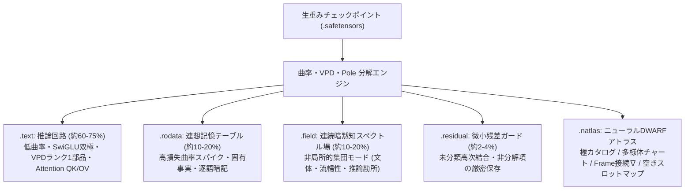
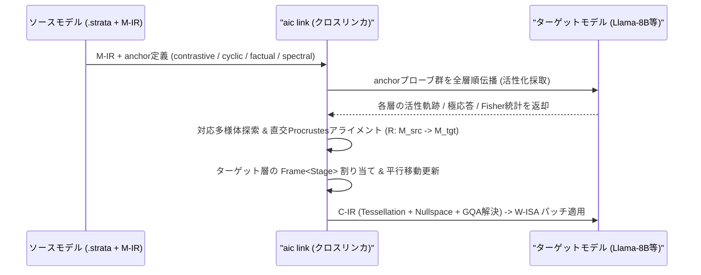

# 第5部：Neural ELF・逆コンパイラ（`aic lift`）・クロスリンカ仕様

本仕様書では、学習済みモデルの生の重み行列（`.safetensors`）を構造化バイナリ **Neural ELF（`.nelf`）** へと分解し、人間が読み書きできる高級言語 `Strata`（`.strata`）へ引き上げる**逆コンパイラ `aic lift`**、その往復可逆性を保証する**往復忠実性定理**、そして異なるモデル・サイズ間での回路移植を実現する**ハイブリッド・クロスリンカ `aic link`** の仕様を定義する。

---

## 1. 5セクション Neural ELF（`.nelf`）フォーマット仕様

古典計算機のELF形式がプログラムを `.text`（実行コード）、`.rodata`（読み取り専用定数）、`.debug_info`（DWARFシンボル表）に分けるのと同様に、`ai-compile` は2026年の重み空間物理学に基づき、任意のTransformerパラメータ集合 $\Theta$ を**4つの直交的・加法的な重みセクション**と**1つのメタデータセクション（`.natlas`）**へ構造化する：

$$
\Theta = \Theta_{\text{.text}} \oplus \Theta_{\text{.rodata}} \oplus \Theta_{\text{.field}} \oplus \Theta_{\text{.residual}} \quad + \quad \text{Metadata}(\text{.natlas})
$$



### 1.1 各セクションの物理的定義

1. **`.text`（推論・アルゴリズム回路セクション）**:
   - **特徴**: 損失曲率スペクトルが平坦（$\lambda(H) < \tau_{\text{curv}}$）で、VPDによる敵対的アブレーション試験をパスしたスパースな構造化部品群。
   - **格納形式**: SwiGLUの `+pole` / `-pole` 対、VPDランク1成分 $(u_l^c, v_l^c, s_c)$、およびAttentionヘッドの双線形行列 $(W_{QK}, W_{OV})$。`Strata` 上では `pole`, `dipole`, `subspace`, `manifold`, `flow` へ逆コンパイルされる。

2. **`.rodata`（高曲率・連想知識セクション）**:
   - **特徴**: キャリブレーションデータ上のヘッシアン対角／K-FAC曲率が鋭いピークを示す局所パラメータ方向（Goodfire *Loss Curvature* 分離基準 $\lambda(H) \ge \tau_{\text{curv}}$）。
   - **格納形式**: キー・値アンカー対と局所共分散逆行列 $C^{-1}$ を伴う連想メモリ行群。`Strata` 上では `rodata<K, V>` テーブルと `entry` 群へ逆コンパイルされる。

3. **`.field`（巨視的連続暗黙知スペクトル場セクション）**:
   - **特徴**: 単一のニューロン極や局所回路へ切り出しにくいが、語彙流暢性・トーン・安全性直観・思考スタイルとして数千の極と多層にわたってコヒーレントに協調する広域スペクトルモード。
   - **格納形式**: 層横断的な低〜中ランク特異ベクトル束 $(U_S, \Sigma_S, V_S)$ および対応するFisher情報計量 $G_S$。`Strata` 上では `field` 型として抽出され、`decouple` / `temper` / `blend` による直接編集の対象となる。

4. **`.residual`（2〜4% 微小残差ガードセクション）**:
   - **特徴**: *“Neural Networks Are Already Clean”* が示した「未解明・非単調結合のまま残る2〜4%の微小成分」および近似誤差の残余。
   - **役割**: 元の重み行列と既知3セクションの厳密な差 $\Theta_{\text{.residual}} := \Theta - (\Theta_{\text{.text}} + \Theta_{\text{.rodata}} + \Theta_{\text{.field}})$ として保存され、再コンパイル時に**Nullspace保護のもとで元の位置へ再加算**される。これにより、未解明の数%を強制的に消してモデルが壊れる事故を防ぐ。

5. **`.natlas`（ニューラルDWARF・座標辞書セクション）**:
   - 従来のデバッグシンボル表（DWARF）に相当するJSON/バイナリ索引。各モデルの `Frame<Stage>` 間平行移動行列 $\nabla_{f_1 \to f_2}$、発見された全SwiGLU極の意味ラベル、多様体チャート、休眠極インデックス一覧、保護用活性化共分散 $K_{\mathcal{P}}$ を保持する。

---

## 2. 逆コンパイラ・パイプライン（`aic lift`）

`aic lift model.safetensors --out workspace/` は、生の重みから5セクション `.nelf` を経由して可読な `.strata` ソースツリーを再構築する4段階パイプラインである。

### ステージ1：損失曲率による `.rodata` / `.text` / `.field` 分離
キャリブレーションコーパス $\mathcal{D}_{\text{cal}}$ 上でK-FAC（Kronecker-Factored Approximate Curvature）近似ヘッシアンを算出し、パラメータ空間を曲率閾値 $\tau_{\text{curv}}$ と局所集中度（Sparsity Ratio）に基づいて分解する：
- 高曲率・高局所性 $\implies \Theta_{\text{.rodata}}$
- 低〜中曲率・高因果帰属スパース性 $\implies \Theta_{\text{.text}}$
- 低曲率・広域スペクトル協調性 $\implies \Theta_{\text{.field}}$

### ステージ2：VPD ＆ SwiGLU 双極（`+pole` / `-pole`）抽出
$\Theta_{\text{.text}}$ に対し、VPD（adVersarial Parameter Decomposition）を実行して各層行列をランク1部品の集合へ分解し、SwiGLU MLPニューロンについては $w_{\text{up}, i}^\top x > 0$ 側（`+pole`）と $w_{\text{up}, i}^\top x < 0$ 側（`-pole`）の活性化サンプル（Max-Activating Examples）および自動解釈エージェント監査によって極ごとの単一意味ラベルを付与する。

### ステージ3：多様体トポロジー同定（Manifold Chart Discovery）
抽出された極および部分空間群に対し、特徴空間上での幾何構造を自動判定して適切な `Strata` 型を選択する（段階的型上げ）：
- 単独の非負極・対極 $\implies$ `pole` / `dipole`
- PCA累積寄与率 $99\%$ 以上かつ局所線形性（曲率 $\kappa \approx 0$） $\implies$ `subspace<k>`
- 局所接空間が連続回転する非線形構造（パーシステントホモロジー $H_1 \ne 0$ による円環 $S^1$ や $T^k$ の検出） $\implies$ `manifold <Name> : S1` + チャート・`anchor` 生成

### ステージ4：`.strata` コード生成と差分リンク
再構成された M-IR グラフに対し、同一の意味機能・同一の層間因果鎖を共有するノードを `flow` ブロックへとまとめ、`Strata` ソースファイルを出力する。人間（またはWSPエージェント）がこの `.strata` ファイルを編集した後、`aic compile` を呼ぶと、**元の `.nelf` に保存されていた未変更部分と `.residual` を保ったまま差分のみを再コンパイル**する。

---

## 3. 往復忠実性（Round-Trip Faithfulness）定理

逆コンパイルと再コンパイルが「壊れない」ことを保証するため、以下の形式定理を仕様の基礎とする。

### 定理（`.residual` 保護下の往復忠実性）

あるモデルパラメータ $\Theta$ に対し、`aic lift` が構築した `.nelf` 分解 $\Theta = \Theta_{\text{.text}} + \Theta_{\text{.rodata}} + \Theta_{\text{.field}} + \Theta_{\text{.residual}}$ を考える。ここで $\Theta_{\text{.text}}$ 内の各多様体変換は誤差 $\delta$ でテッセレーション表現されているとする。

1. **ゼロ差分往復（Zero-Diff Identity）**:
   生成された `.strata` ソースに編集を加えずに再構築したパラメータ $\Theta' = \text{compile}(\text{lift}(\Theta), \text{preserve}=\Theta_{\text{.residual}})$ は、恒等再構成において各層パラメータのフロベニウス誤差がゼロ（テッセレーション非適用時 $\|W' - W\|_F = 0$、曲面再離散化時でもチャート誤差 $\delta$ 以内）に保たれる：
   $$
   \mathbb{E}_{x \sim \mathcal{D}_{\text{eval}}} \left[ D_{\text{KL}}\!\left( P_{\Theta}(\cdot \mid x) \,\|\, P_{\Theta'}(\cdot \mid x) \right) \right] = O(\delta^2)
   $$

2. **差分パッチ保存則（Differential Edit Isolation）**:
   ユーザーが編集したモジュール部分に対応する M-IR 差分 $\Delta \mathcal{M}$ のみを再コンパイルして $\Delta \Theta_{\text{safe}}$ を生成し、第4部アルゴリズム3のNullspace射影（許容クロストーク $\epsilon$、保護空間 $\mathcal{P} \supseteq \text{span}(\Theta_{\text{.residual}} \cup \text{Untouched})$）を適用するとき、未編集領域の入力分布 $\mathcal{D}_{\neg \text{target}}$ に対する出力KLダイバージェンス変動は次の2次境界内に抑えられる：
   $$
   \mathbb{E}_{x \sim \mathcal{D}_{\neg \text{target}}} \left[ D_{\text{KL}}\!\left( P_{\Theta}(\cdot \mid x) \,\|\, P_{\Theta + \Delta \Theta_{\text{safe}}}(\cdot \mid x) \right) \right] \le C \cdot (\epsilon^2 + \delta^2 + E_{\text{leak}})
   $$
   ここで $E_{\text{leak}}$ は `when` 共鳴ゲート外へのテール活性化エネルギーであり、SwiGLU の負側指数減衰により急速に 0 へ収束する。

---

## 4. ハイブリッド・リンカと異種モデル間クロスコンパイル（`aic link`）

高級言語としての `Strata` 最大の利点は、あるモデル（例：`Qwen3-32B`）で書かれた（または `aic lift` で抽出された）回路や知識修正パッチを、構造・隠れ次元・層数の異なる別モデル（例：`Llama-3.1-8B`）へ移植できることにある。`aic link` は2種類の名前解決モードを統合する。

### 4.1 静的シンボル解決（事前解析 `.natlas` リンク）

`--atlas target_model.natlas` が指定され、ソース内の幾何シンボル（例：`MathLoopAnomaly` や `EmpatheticTone`）の識別子または正規化アンカーハッシュが `.natlas` 内に既に登録されている場合、探索コストゼロで直ちに座標解決・`Frame` マッピングを行う。

### 4.2 `anchor` 駆動型ダイナミック・クロスコンパイル

別モデルへ移植する際、`target.natlas` に該当概念が未登録であったり、そもそもターゲットモデル側の隠れ次元 $d'$ や層数 $L'$、GQAグループ数がソースと異なったりする場合は、ソースコードの型宣言内に書かれた **`anchor` ブロック**を用いて動的解決（Cross-Model Linking）を実行する。



#### クロスアライメントの数学的手順

1. **アンカー応答採取**:
   各 `anchor`（例：`contrastive(pos: [...], neg: [...])`、`cyclic([...])`、`factual(...)`）の入力プローブ群をターゲットモデルに通し、各層 $l \in \{1, \dots, L'\}$ の残差表現・SwiGLU極活性・Attentionパターンを計測する。
2. **相同多様体・最適層の特定**:
   - `pole` / `dipole` に対しては、正負プローブ間の分離度（Fisher判別比またはROC-AUC）が最大化する層区間およびSwiGLU極または方向ベクトル $\hat{e}_{\text{tgt}}$ を同定する。
   - `Manifold<Topo, k>`（例：$S^1$）に対しては、線形プローブ／測地線距離保存埋め込みによりターゲット側の $k$ 次元座標部分空間 $U_{\text{tgt}} \in \mathbb{R}^{d' \times k}$ を抽出する。
   - `field` に対しては、アンカープロンプト集合上でターゲットモデルの勾配・Fisher共分散の上位特異空間を抽出し、連続場ハンドルとして束縛する。
3. **直交Procrustes／チャート整合**:
   ソースM-IR上で定義された標準チャート座標系 $\mathcal{M}_{\text{src}} \in \mathbb{R}^{N \times k}$ と、ターゲット上で発見されたアンカー点群埋め込み $\mathcal{M}_{\text{tgt}} \in \mathbb{R}^{N \times k}$ との間で、直交変換（Procrustes問題）を解く：
   $$
   R^* = \arg\min_{R \in O(k)} \| \mathcal{M}_{\text{src}} R - \mathcal{M}_{\text{tgt}} \|_F
   $$
   この $R^*$ により、ソースコード上の多様体写像 $\Phi$ や接空間方向がターゲットモデルの固有座標軸へ無損失に回転・射影される。
4. **ターゲット固有の C-IR / W-ISA 再低下**:
   座標解決された M-IR に対し、第4部の C-IR パス（ターゲットのSwiGLU幅・GQAヘッド共有制約・Nullspace保護を考慮したテッセレーションと射影）を実行し、ターゲットモデル用の最終重みパッチを生成する。

> [!TIP]
> **完全ゼロスクラッチからの移植とハイブリッド移植**：
> `aic link` は既存のターゲットモデルが持つ「概念アンカーへの素地」を再利用するだけでなく、ターゲット側に存在しない新機能（例：新規の計算規則や構造化状態遷移）を含んでいる場合でも、アンカーで特定した入力多様体 $M_{\text{in}}$ から出力多様体 $M_{\text{out}}$ への**不足回路だけをターゲットの `--target=in-place` 空きスロットまたは `--target=elastic` 増設極へ自動合成して接続**する。

---

## 5. 2次元トーラス多様体（`T2`）の発見と `aic build-nelf` 差分再構成

### 5.1 $T^2$ トーラス多様体のスペクトル同定
`lift_loaded_model` のステージ3では、1次元円環（$S^1$）が検出されない残差・層サンプル列（$N \ge 16$、$d \ge 5$）に対し、保護空間直交補空間への射影・中心化を行った上で上位4特異値 $(\sigma_1, \sigma_2, \sigma_3, \sigma_4)$ と2つの直交2次元平面 $(v_1, v_2)$・$(v_3, v_4)$ の動径変動係数 $\text{CV} = \text{std}(r)/\text{mean}(r)$ を検査する。2つの独立周期平面が共に閉じた円環幾何（$\sigma_1 > 10^{-3}$、$\sigma_2/\sigma_1 > 0.60$、$\sigma_3/\sigma_2 > 0.45$、$\sigma_4/\sigma_3 > 0.60$、各平面の $\text{mean}(r) > 10^{-3}$ かつ $\text{CV} < 0.28$）を示す場合、`TorusManifold_L<l> : T2` として5次元正規直交基底 `{e0, v_1, v_2, v_3, v_4}` を `.natlas` へ束縛し、生成 `.strata` 末尾に自己検証契約 `test VerifyLiftedFaithfulness` を自動付与する。

### 5.2 `aic build-nelf` による `.nelf` + `.strata` 往復再コンパイル
`aic lift` で抽出した `.nelf` ディレクトリと編集済み（または未編集の）`.strata` ファイルを再結合して `.safetensors` チェックポイントを再構成する CLI サブコマンドとして `aic build-nelf` を提供する：

```bash
./build/aic build-nelf <file.strata> --nelf <nelf_dir> --out <out_model_dir> \
    [--target in-place|elastic] [-I <dir>] [--verify-orig <orig_model_dir>]
```

- **無編集時（恒等往復）**: `mir_has_mutations(mir) == false`（宣言と `test VerifyLiftedFaithfulness` のみ）のとき、`recompile_nelf_with_patch` は `.text + .rodata + .field + .residual` の直和再構成のみを実行し、`--verify-orig` においてほぼゼロ差分（`mean_kl_div: 0.000000`）を保証する。
- **編集時（差分パッチ適用）**: `.strata` の `flow` 本体に追記した操作のみを、`nelf.residual_weights`（`.residual` セクション）に対するNullspace保護制約付きで再コンパイルし、既存回路・残差を保った差分モデルを生成する。
